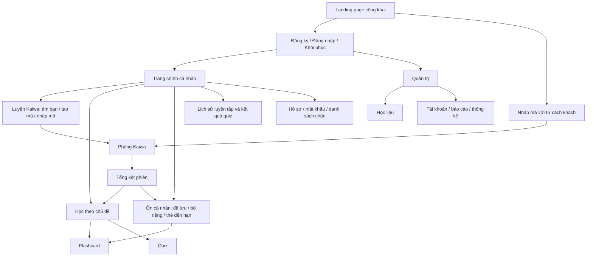
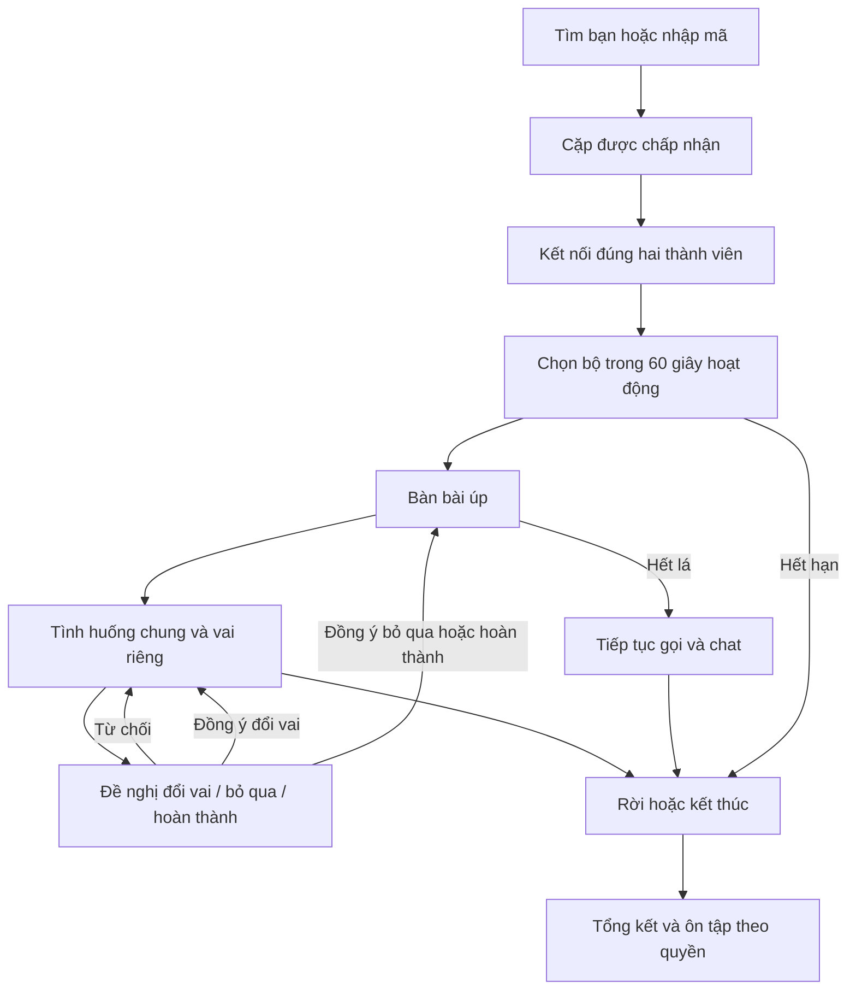

# 04 — UI/UX Design Specification

| Thuộc tính | Giá trị |
|---|---|
| Sản phẩm | Chiikaiwa |
| Phiên bản | 1.1 |
| Ngày | 02/11/2026 |
| Phạm vi | UX/UI Specification cho MVP trên laptop/desktop |

## 1. Introduction & Scope

Tài liệu xác định cấu trúc thông tin, luồng tương tác, màn hình và phản hồi để thiết kế trên Figma và triển khai frontend. Nguồn nghiệp vụ là Project Overview 1.0 (01-project-overview.md), SRS 1.0 (02-srs.md) và Product Backlog 1.0 (03-product-backlog.md). SRS giữ thẩm quyền về hành vi; backlog xác định phạm vi bàn giao, không cho phép bỏ chức năng P1/P2.

Bao gồm người truy cập, người học, khách theo mã mời và Admin. Mục 2.5 ghi nhận hướng visual đã chốt sau review. Chi tiết bố cục, tokens, source và bản demo được mô tả tại [UI hiện hành](../development/ui.md); tài liệu này không chứa toàn bộ mockup, thiết kế nhân vật hay component library. Các sơ đồ dưới đây chỉ biểu diễn cấu trúc và luồng.

Quy ước: UF là luồng, SC là màn hình hoặc trạng thái màn hình có mục đích riêng. FR/BR/NFR/UC/AT và PB giữ nguyên mã nguồn. Một SC không bắt buộc tương ứng một URL; form phụ có thể là vùng nội dung hoặc hộp thoại ở bước thiết kế. Các nguyên tắc trong tài liệu là ràng buộc trải nghiệm; hình thức thể hiện theo giao diện Chiikaiwa đã chốt tại mục 2.5, không làm thay đổi quy tắc nghiệp vụ.

## 2. UX Principles & Visual Direction

### 2.1. UX Goals & Design Principles

- Cho người dùng chọn luyện cùng bạn hoặc ôn độc lập từ trang chính; không buộc hoàn thiện thông tin tùy chọn để bắt đầu.
- Luôn nhận biết đang chờ hệ thống hay đối tác, thao tác đã được xác nhận hay còn đang gửi.
- Tôn trọng quyền chủ động: không tự tìm lại, nới bộ lọc, bật thiết bị hoặc chuyển sang cuộc gọi ngoài các bước xác nhận đã quy định.
- Giảm áp lực: diễn đạt trung tính khi bị từ chối, trả lời sai hoặc quá hạn ôn; không gán điểm quiz hay số phút gọi thành năng lực nói.
- Giữ vai riêng, ghi chú riêng và dữ liệu chung phân biệt rõ; thao tác dễ thương không thay thế phản hồi nghiệp vụ.

### 2.2. Character-driven Kawaii Direction

Sử dụng nhiều nhân vật Chiikawa, giữ đặc điểm và biểu cảm nhận diện của từng nhân vật; không giới hạn vào một mascot. Tinh thần friendly, playful, cozy, soft-rounded; pastel tươi với điểm nhấn rõ, bố cục sạch và hiện đại. Nhân vật góp phần dẫn dắt, đồng hành và phản hồi, không trở thành cơ chế trò chơi mới.

Chưa chốt danh sách nhân vật, phân vai cho từng nhân vật hoặc tài nguyên hình ảnh. Không bổ sung chọn/nuôi nhân vật, phần thưởng, streak, nhiệm vụ hay hệ thống cảm xúc của nhân vật.

### 2.3. Visual & Interaction Principles

Ưu tiên thứ bậc nội dung, nhãn dễ hiểu và phản hồi đúng trạng thái. Màu sắc hỗ trợ phân biệt nhưng luôn có chữ hoặc biểu tượng kèm theo. Chuyển động biểu đạt thay đổi, quan hệ trước–sau hoặc xác nhận thao tác; không kéo dài chờ để trình diễn. Trong phòng, cuộc gọi, tình huống, vai và điều khiển an toàn có ưu tiên cao hơn nhân vật.

### 2.4. Design Constraints

Nghiệm thu trên Windows/Chrome, viewport từ 1366 × 768 CSS pixel; đây là vùng nội dung trình duyệt, không phải độ phân giải vật lý của màn hình. Kiểm tra cả kích thước tối thiểu, kích thước lớn hơn và khi thay đổi cửa sổ. MVP hỗ trợ web trên laptop/desktop; không thiết kế hoặc nghiệm thu giao diện mobile và không xây ứng dụng di động. Các thời hạn 30 giây xác nhận, 60 giây chọn bộ, 10 phút mã mời, 5 phút phục hồi và 15 phút ôn thử lấy theo trạng thái server. Animation không dừng hoặc gia hạn thời hạn. Giữ giới hạn MVP và ma trận quyền của SRS.

### 2.5. Giao diện đã chốt

Giao diện Chiikaiwa dùng nền kem, mực mận, hồng phấn và xanh dịu. Trang chính dùng bố cục hai vùng: lối luyện hội thoại bên trái, khu học cá nhân bên phải; nội dung ngắn gọn. Phòng luyện có bố cục gọn. [Mô tả và source hiện hành](../development/ui.md).

Thao tác thường xuyên có thể dùng icon với tên truy cập được, tooltip, focus và trạng thái rõ. Lưu từng mục kiến thức dùng sao ở góc mục đó; sao đã lưu có cả trạng thái nhấn và hình dạng tô đầy. Rời phòng và xác nhận đồng thuận vẫn có nhãn chữ.
## 3. Information Architecture & Navigation

### 3.1. Sitemap

### 3.2. Navigation Structure

Landing giới thiệu mục đích, hành trình luyện và cách thử bằng mã; cung cấp Đăng nhập, Đăng ký, Nhập mã mời. Không hiển thị dữ liệu học tập cá nhân. Sau đăng nhập, người học vào trang chính riêng với lối vào Luyện Kaiwa, Học theo chủ đề, Ôn cá nhân và Lịch sử. Hồ sơ, mật khẩu, danh sách chặn và đăng xuất nằm trong nhóm tài khoản. Trang chính không thêm bảng thành tích hoặc chỉ số ngoài phạm vi.

Kho học liệu và ôn cá nhân giữ nhãn phạm vi đang học; quay lại phải về đúng chủ đề, bộ hoặc danh sách nguồn. Kết quả quiz độc lập vẫn có lối mở lại, không bắt buộc thuộc một phiên gọi.

### 3.3. Role-based Navigation

| Đối tượng | Điều hướng |
|---|---|
| Chưa đăng nhập | Landing, tài khoản, nhập mã khách; chức năng cá nhân yêu cầu đăng nhập |
| Người học | Trang chính và toàn bộ dữ liệu của mình; không có menu Admin |
| Khách đang thử | Phòng được nhận, tổng kết, kiến thức đã lưu tạm, flashcard/quiz thuộc lượt; không có tạo phòng, ghép tự động, bộ cá nhân hoặc lịch sử lâu dài |
| Admin | Khu quản trị riêng: học liệu, tài khoản, báo cáo, thống kê; không có quyền quan sát phòng hoặc dữ liệu học riêng |

### 3.4. Page Access & Redirect Behavior

Truy cập trang riêng khi chưa xác thực dẫn tới đăng nhập, sau đó chỉ trở lại đích còn hợp lệ và đúng quyền. Admin đăng nhập vào khu quản trị. Không tự đưa người dùng vào cuộc gọi chỉ vì có đường dẫn phòng. Tải lại phòng lấy trạng thái và quyền hiện tại; phiên đã kết thúc dẫn tới tổng kết nếu còn quyền. Không có quyền hiển thị thông báo trung tính và lối về không gian phù hợp, không lộ dữ liệu tài nguyên.

Khi đang tìm/chờ mã, chuyển sang luồng khác phải hủy luồng hiện hành và chờ xác nhận giải phóng; lỗi hủy không được giả định đã rảnh. Trong cuộc gọi, điều hướng ra ngoài phải giải thích hậu quả kết thúc cho cả hai. Tải lại hoặc mất tab được xử lý theo phục hồi, không hứa rằng đóng trình duyệt luôn gửi được lệnh rời. Hết xác thực yêu cầu đăng nhập lại và tải quyền mới; không báo cuộc gọi đã kết thúc nếu chưa có xác nhận nghiệp vụ.

## 4. User Flows

Mỗi hàng ghi điểm vào/điều kiện, chuỗi tương tác và kết quả; ngoại lệ dẫn đến trạng thái tại mục 6. Truy vết chi tiết tại mục 9.

| Luồng | Điểm vào và điều kiện | Tương tác, phản hồi và kết quả | Thay thế và ngoại lệ |
|---|---|---|---|
| UF-01 Tài khoản | Landing hoặc trang riêng cần xác thực | Đăng ký → xác nhận tạo tài khoản → đăng nhập → trang chính; sửa hồ sơ → lưu → hiển thị bản xác nhận | Email trùng, sai thông tin, khóa tài khoản; trường tùy chọn được bỏ trống. Đổi mật khẩu hoặc yêu cầu reset → phản hồi trung tính → mở liên kết → đặt mới; link sai/hết hạn/đã dùng có đường xin lại |
| UF-02 Ghép tự động | Trang chính, tài khoản rảnh | Chọn trình độ/thời lượng; mở bộ lọc tùy chọn; kiểm tra thiết bị có thể bỏ qua → tìm → xem đối tác/điểm chung/thời lượng → đồng ý → chờ người kia → vào phòng | Hủy/từ chối/hết 30 giây giải phóng, không tự tìm lại; sau 2 phút cho chờ, sửa tiêu chí, mã mời hoặc ôn; sửa hủy lượt cũ trước tìm mới |
| UF-03 Mã mời | Trang chính hoặc nhập mã từ landing | Chủ tạo mã → sao chép mã → người học/khách nhập → chờ chấp nhận → chủ nhận một đối tác → cả hai kết nối | Sai/hết hạn/đã dùng/chặn không cấp phòng; nhiều yêu cầu chỉ nhận một; người xin có thể hủy; chủ hủy vô hiệu mã; lỗi kết nối có đường thoát |
| UF-04 Phòng và thiết bị | Đã có quyền của cặp | Kết nối → đủ hai người bắt đầu phiên → bật/tắt thiết bị chủ động, chat, chia sẻ → rời → tổng kết | Không cấp mic/cam vẫn tham gia; chia sẻ bị từ chối không ảnh hưởng thẻ/chat; một người chia sẻ; mất mạng chờ tối đa 5 phút, đối tác được rời trước |
| UF-05 Chọn và bốc | Hai thành viên đã kết nối | Cùng xem bộ → random người điều khiển → người giữ quyền chọn trong 60 giây → bàn bài úp → người giữ quyền bốc → nhận tình huống chung/vai riêng | Bấm đồng thời chỉ một kết quả, đồng bộ lại; hết thời gian chọn kết thúc có lý do; không phân lượt bốc; không lộ nội dung lá úp |
| UF-06 Luyện và đồng thuận | Có lá hiện hành | Đọc vai → gọi/chat, tự mở gợi ý → đề nghị đổi vai/bỏ qua/hoàn thành → đối tác đồng ý → đổi trạng thái đã xác nhận | Từ chối giữ nguyên; chỉ một đề nghị; disconnect vô hiệu đề nghị chưa hoàn tất; hết lá vẫn gọi/chat, không tự đổi bộ |
| UF-07 Lưu và ghi chú | Học liệu hoặc phòng đúng quyền | Lưu từng từ/cấu trúc → phản hồi đã lưu; nhập note riêng → đang lưu → đã lưu → mở lại trong tổng kết | Lưu trùng giữ một mục và các nguồn; bỏ lưu không reset FSRS; lỗi note giữ bản nhập trong màn hình và cho thử lại, không giả thành công |
| UF-08 Flashcard và bộ riêng | Chủ đề, đã lưu, đến hạn hoặc bộ cá nhân | Chọn phạm vi → mặt hỏi → mở đáp → xem Again/Hard/Good và hạn dự kiến → đánh giá → xác nhận lịch mới → tiếp tục/kết thúc | Chỉ xem không đánh giá; stale/retry không ghi hai lần; rỗng có đường tới học liệu. Tạo/đổi tên/xóa bộ, thêm/bỏ thẻ, tạo/sửa/xóa thẻ thủ công có phản hồi riêng |
| UF-09 Quiz | Chủ đề/tổng kết hoặc kết quả cũ | Tạo lượt → từng câu, điều hướng ngang → rà câu chưa trả lời → nộp → kết quả/giải thích → học liên quan hoặc làm lại | Không câu thì không tạo bài; bỏ trống được nộp sau nhắc; timeout kiểm tra cùng lượt; không tự tạo lượt mới; không đổi FSRS |
| UF-10 Tổng kết/lịch sử | Phiên đã bắt đầu và kết thúc | Xem lý do/thời lượng/lá/đã lưu/note → tự đánh giá tùy chọn → mở chủ đề/ôn/quiz; người học quay lại từ lịch sử | Phiên chưa bắt đầu không tạo lịch sử; gián đoạn có lý do; khách chỉ lượt hiện tại và hết quyền sau 15 phút; đăng ký không chuyển dữ liệu thử |
| UF-11 An toàn | Đối tác trong phiên hoặc lịch sử đúng quyền | Báo cáo → lý do/mô tả → gửi → xác nhận tiếp nhận; chặn là hành động riêng; danh sách chặn cho gỡ bản của mình | Chặn trong phiên kết thúc cho cả hai; báo cáo không tự chặn; không có tệp đính kèm hoặc trang theo dõi báo cáo cho người học |
| UF-12 Học liệu Admin | Admin, khu học liệu | Soạn bộ/tình huống/vai/kiến thức/câu quiz → lưu nháp → kiểm tra thiếu → xuất bản; có thể sửa hoặc ẩn | Thiếu nội dung/liên kết báo tại trường; không xuất bản một phần; sửa/ẩn giữ dữ liệu đã dùng; không có giao diện nhiều phiên bản |
| UF-13 Vận hành Admin | Admin | Xem tài khoản → khóa/mở khóa; xem báo cáo → xử lý/kết luận; xem bốn thống kê tổng hợp | Lỗi/xung đột phải tải lại trước ghi; không truy cập note/thẻ riêng/media; thống kê lỗi không hiển thị thành số 0 |

## 5. Screen Specifications

### 5.1. Screen Inventory & Specifications

Mọi SC áp dụng trạng thái chung ở mục 6; cột trạng thái dưới đây ghi khác biệt cần thiết. Form phụ không bắt buộc mở trang mới.

| ID / Màn hình | Mục đích, đối tượng và điểm vào | Nội dung / hành động / đích tiếp theo | Trạng thái đặc thù |
|---|---|---|---|
| SC-01 Landing | Công khai, truy cập website | Giới thiệu luyện 1–1, thẻ/vai, ôn tập; dàn nhân vật; đăng ký/đăng nhập → SC-02; nhập mã → SC-06; người đã đăng nhập có lối vào SC-03 | Không biến thành trang chính cá nhân; không có dữ liệu hay lời chứng thực giả |
| SC-02 Tài khoản | Công khai hoặc phiên cần xác thực | Form đăng ký, đăng nhập, xin reset, đặt mật khẩu; nhãn/trợ giúp/lỗi tại trường; quay landing hoặc vào SC-03/SC-19 theo quyền | Đang gửi, email trùng, sai thông tin, khóa, reset hết hạn, gửi thư lỗi; không tiết lộ email tồn tại qua reset |
| SC-03 Trang chính | Người học sau đăng nhập | Luyện Kaiwa → SC-05/06; học chủ đề → SC-11; ôn cá nhân → SC-12; lịch sử → SC-16; menu tài khoản → SC-04/18 | Tài khoản mới có hướng dẫn ngắn tại hành động; luồng đang chiếm chỗ có lối trở lại, không tạo luồng thứ hai |
| SC-04 Hồ sơ và mật khẩu | Người học từ tài khoản | Tên, avatar mặc định, cấp độ; thông tin tùy chọn theo SRS; lưu; đổi mật khẩu; quay trang chính | Chưa có trình độ thì yêu cầu khi tìm tự động; không ép trường tùy chọn; không upload avatar |
| SC-05 Tìm Tomodachi | Người học đang rảnh | Trình độ, thời lượng, chênh một cấp; mục tiêu/sở thích/tiếng mẹ đẻ; bộ lọc riêng; kiểm tra thiết bị tùy chọn; tìm/hủy; đề nghị hiển thị đối tác, điểm chung, thời lượng và đồng hồ; nhận → SC-07 | Đang tìm, chờ lâu, đang chờ bạn đồng ý, đang chờ đối tác, từ chối/hết hạn; không hiển thị điểm phù hợp giả |
| SC-06 Phòng mời | Người học tạo/nhập; khách chỉ nhập | Mã và hạn, sao chép, hủy; form nhập mã; hướng dẫn khách và thời hạn dữ liệu; thiết bị tùy chọn; chủ thấy yêu cầu và nhận/từ chối; được nhận → SC-07 | Mã không dùng được, yêu cầu đang chờ, bị từ chối, mất chỗ; không tiết lộ tình trạng riêng của phòng khác |
| SC-07 Kết nối phòng | Cặp được cấp quyền từ SC-05/06 | Trạng thái kết nối mình/đối tác, thiết bị thực tế, tiếp tục không mic/cam, thử lại/hủy; đủ kết nối → SC-08 | Không bắt đầu đồng hồ chọn bộ trước khi đủ hai người; lỗi cấp quyền/media, chờ phục hồi |
| SC-08 Phòng Kaiwa | Hai thành viên | Video, điều khiển mic/cam/chia sẻ/rời; trạng thái kết nối và thời lượng; danh sách bộ → bàn bài → tình huống/mục tiêu/vai; đổi vai/bỏ qua/hoàn thành; lấy quyền điều khiển; mở SC-09/17 | Chọn bộ có thời gian; chờ bốc; lá hiện tại; đề nghị đồng thuận; hết lá; chia sẻ; reconnect; ended → SC-10 |
| SC-09 Vùng phụ trong phòng | Thành viên từ SC-08 | Chat riêng với phòng; gợi ý mở cá nhân, lưu từng kiến thức; note riêng; mở/thu gọn và giữ bản nhập khi đổi vùng | Chat mới có chỉ báo không che vai; note đang lưu/lỗi; không hứa phục hồi chat khi vào lại; mất mạng giữ dữ liệu đã xác nhận |
| SC-10 Tổng kết | Thành viên phiên đã bắt đầu | Bộ/lá/trạng thái/lý do/thời lượng; đã lưu, note riêng; tự tin 1–5 và nhận xét tùy chọn; mở học liệu, flashcard, quiz; báo cáo/chặn | Chưa chọn được bộ không có đường ôn bộ giả; khách có thời hạn còn lại; hết hạn → SC-20 |
| SC-11 Kho và chi tiết chủ đề | Người học; khách chỉ bộ của lượt | Bộ theo chủ đề/cấp độ; kiến thức, cách đọc/nghĩa/ví dụ; lưu/bỏ lưu; học toàn bộ → SC-14, quiz → SC-15 | Không có bộ/nội dung; bản lịch sử được phân biệt; không lộ vai hoặc đáp án quiz qua kho |
| SC-12 Ôn cá nhân | Người học, khách giới hạn đã lưu tạm | Danh sách đã lưu và nguồn; thẻ đến hạn; bộ riêng → SC-13; chọn phạm vi học → SC-14; bỏ lưu | Mới/đến hạn/quá hạn không mang sắc thái phạt; bỏ lưu giải thích giữ tiến độ; rỗng có lối về chủ đề |
| SC-13 Bộ và thẻ thủ công | Chủ sở hữu từ SC-12 | Tạo/đổi tên/xóa bộ; thêm/bỏ thẻ nguồn; tạo/sửa/xóa mặt hỏi–đáp; học → SC-14 | Trùng mục không thêm hai lần; xác nhận xóa nêu đúng phạm vi; không tự sinh quiz; form lỗi giữ dữ liệu nhập |
| SC-14 Học flashcard | Người học/khách còn quyền | Nhãn phạm vi; mặt hỏi, mở đáp; Again/Hard/Good với nghĩa và lịch dự kiến; sau ghi thành công tiếp tục; xem lịch sử đánh giá của thẻ; trở về nguồn | Chưa mở đáp không đánh giá; đang gửi khóa đánh giá lặp; stale cần tải lại; hết thẻ hiện thời cho kết thúc hoặc về nguồn, không tự tạo review |
| SC-15 Quiz và kết quả | Chủ lượt từ chủ đề/tổng kết/lịch sử | Một câu mỗi trang; số câu, điều hướng ngang Trước/Tiếp và chọn câu; giữ đáp án khi chuyển; nộp toàn lượt; kết quả từng câu, đáp án/giải thích/kiến thức liên quan, làm lại | Chưa trả lời/đã trả lời/hiện tại phân biệt bằng nhãn; nộp khi còn trống cần xác nhận; đang chấm/đã nộp; mất phản hồi không tạo lượt mới |
| SC-16 Lịch sử | Người học từ SC-03 | Danh sách phiên, thời gian/đối tác/lý do; mở SC-10; danh sách kết quả quiz gồm cả quiz độc lập → SC-15 | Phòng chờ không phải phiên; Khách là nhãn đối tác; dữ liệu rỗng khác lỗi tải |
| SC-17 Báo cáo/chặn | Thành viên từ phòng/tổng kết | Đúng đối tác/phiên; lý do/mô tả; gửi và xác nhận tiếp nhận; chặn riêng có giải thích kết thúc nếu đang gọi | Không tự chặn khi báo cáo; không tự kết luận vi phạm; lỗi gửi cho thử lại; không theo dõi báo cáo phía người học |
| SC-18 Danh sách chặn | Người học từ tài khoản | Đối tác đã chặn, gỡ bản chặn của mình; quay tài khoản | Gỡ không bảo đảm ghép được nếu phía kia còn chặn; danh sách rỗng/lỗi |
| SC-19 Quản trị | Admin sau đăng nhập | Khu học liệu: danh sách, form bộ/tình huống/hai vai/kiến thức/câu quiz, nháp/xuất bản/ẩn; khu tài khoản: danh sách, khóa/mở; khu báo cáo: chi tiết, trạng thái, kết quả; khu thống kê: tài khoản/phiên/review/quiz đã nộp | Thiếu nội dung, lỗi liên kết, xung đột, xác nhận xuất bản/ẩn/khóa; không có màn xem dữ liệu riêng; thống kê chưa tải không dùng số giả |
| SC-20 Hết quyền / không truy cập được | Khách hết hạn, đường dẫn sai hoặc ngoài quyền | Giải thích ngắn, quay landing/trang chính hoặc đăng nhập theo danh tính; khách có lối đăng ký và thông báo không chuyển dữ liệu thử | Không tiếp tục hiển thị dữ liệu tạm đã hết quyền; không suy đoán tài nguyên tồn tại cho người không có quyền |

### 5.2. Phòng Kaiwa

Bố cục laptop/desktop cố định ba vùng: hai khung người luyện ở trái, thẻ tình huống ở giữa, vùng ghi chú/gợi ý/chat ở phải có thể ẩn. Header và điều khiển cuộc gọi/rời phòng nằm ngoài vùng cuộn. Phòng chiếm chiều cao viewport; danh sách bộ, nội dung vai dài và nội dung công cụ cuộn riêng trong vùng tương ứng, không đẩy toàn trang desktop. Ẩn công cụ mở rộng vùng thẻ. Với cửa sổ hẹp/zoom lớn, cho đọc đủ qua cuộn nội bộ, vẫn giữ thao tác thoát và đường mở/đóng công cụ.

Thẻ roleplay mặc định bằng tiếng Nhật, có tên vai (役割), bối cảnh (背景), tình huống (状況) và mục đích (目的). Tình huống/mục tiêu chung phân biệt với nội dung vai riêng. Nút Tiếng Việt bật bản dịch của chính thẻ/vai đang được phép xem; có thể trở về tiếng Nhật. Chuyển ngôn ngữ chỉ là trạng thái riêng, không đổi vai hoặc nội dung phía đối tác, không mở vai còn lại. Bản demo dùng nội dung dịch soạn sẵn; không có dịch AI hoặc API dịch.

Cuộc gọi và tình huống/vai luôn dễ tiếp cận; chat, gợi ý, note là vùng phụ mở/thu gọn. Chuyển vùng không làm mất note chưa lưu. Khi chia sẻ màn hình, vẫn có đường đọc vai và dùng điều khiển cuộc gọi. Không dùng overlay nhân vật che nội dung hoặc nút rời.

Hiển thị “Bạn đang điều khiển” hoặc “Bạn luyện đang điều khiển”. Người không giữ quyền có nút “Lấy quyền điều khiển”; chỉ cập nhật quyền sau phản hồi server. Khóa chọn/bốc cho người không giữ quyền. Chuyển quyền không đổi bộ/lá, không reset đồng hồ và không yêu cầu duyệt. Cuộn danh sách, hover và vị trí chuột là trạng thái riêng; không phát lại hiệu ứng bốc khi chỉ đồng bộ quyền.

Đề nghị đồng thuận ghi rõ người gửi, hành động và lá hiện tại. Người gửi thấy đang chờ; đối tác có Đồng ý/Từ chối. Không dùng một nút đổi vai như thao tác tức thì. Rời phòng nêu rõ kết thúc cho cả hai; thao tác thoát an toàn luôn dễ tìm và không bị chặn bởi hiệu ứng hoặc lỗi note.

Gợi ý dùng cùng nguồn kiến thức của tình huống nhưng hiển thị trong vùng phụ riêng trên mỗi giao diện phòng. Mỗi người tự mở/đóng, cuộn và xem từ vựng/ngữ pháp; lưu kiến thức và ghi chú chỉ tác động dữ liệu của mình. Các thao tác này không yêu cầu quyền điều khiển và không chuyển màn hình đối tác.

### 5.3. Quiz từng câu, điều hướng ngang

Trình bày một câu trong vùng nội dung ổn định, thanh điều hướng ngang giữ vị trí nhất quán. Đổi câu không nộp bài hoặc chấm câu. Cho quay lại sửa trước nộp; không tự chuyển khi chọn đáp án. Không dùng thao tác vuốt làm cách điều hướng duy nhất.

Ở kích thước nghiệm thu và nội dung mẫu, câu hỏi, lựa chọn và điều hướng phải dùng được mà không cần cuộn trang. Với chữ phóng to hoặc nội dung dài vượt vùng, cho cuộn nội dung cần thiết để đọc đủ; không cắt chữ hoặc thu nhỏ chữ để ép vừa. Kết quả có giải thích dài được phép cuộn. Không hứa giữ đáp án chưa nộp qua đóng tab/tải lại khi chưa có cơ chế lưu tương ứng; cảnh báo rời khi có thay đổi chưa nộp. Lượt đã nộp tải lại phải mở đúng kết quả.

## 6. UI States & Error Handling

| Trạng thái | Quy tắc phản hồi và phục hồi |
|---|---|
| Loading | Nêu nội dung đang tải; giữ bố cục ổn định; tránh hiển thị số 0/rỗng như kết quả; nếu lỗi, kết thúc trạng thái tải và cho hành động phù hợp |
| Empty | Phân biệt chưa có dữ liệu, bộ không có quiz, chưa lưu kiến thức và không có thẻ đến hạn; đưa lối đi trong quyền hiện có |
| Success | Chỉ hiển thị sau xác nhận; phản hồi cục bộ cho lưu/bỏ lưu, không bắt đóng hộp thoại mỗi lần |
| Validation | Gắn lỗi với trường và hướng sửa; giữ dữ liệu không nhạy cảm; không trim mật khẩu; không chỉ đổi màu |
| Network/service error | Giải thích việc chưa hoàn tất; giữ ý định để thử lại; không tạo yêu cầu mới nếu chưa biết thao tác cũ đã ghi hay chưa |
| Conflict | Tải trạng thái mới, giải thích thay đổi; không tự áp lại lựa chọn trên lá, note hoặc tiến độ khác |
| Permission/expiry | Dừng hành động bị cấm, loại dữ liệu không còn được xem; dẫn tới SC-20/đăng nhập; không dùng retry vô hạn |
| Pending write | Khóa chính hành động đang gửi; các thao tác độc lập còn dùng được; note vẫn phân biệt bản nhập và bản đã lưu |

### 6.1. Connection & Session Recovery

Mất media và lỗi API có nhãn riêng theo thông tin xác nhận được. Không tuyên bố đối tác rời chỉ vì một request lỗi. Trong reconnect, hiển thị người đang thiếu và hạn phục hồi, dừng thao tác chung, giữ phần thời gian chọn bộ còn lại. Vào lại tải đúng bộ/lá/vai; không phát lại hiệu ứng như một lượt bốc mới. Đối tác rời hoặc hết hạn chuyển tổng kết, không hồi sinh phiên.

### 6.2. Edge Cases

- Hai tab hoặc hai người gửi cùng lúc: chỉ hiển thị kết quả được chấp nhận; thông báo ngắn thay vì đổ lỗi người bấm chậm.
- Note lỗi khi phiên kết thúc: tiếp tục thể hiện chưa lưu trong tổng kết nếu còn quyền; không ngăn rời cuộc gọi để ép lưu.
- Khách đang quiz/review tại thời điểm hết hạn: dừng ghi, không hiển thị thành công giả; thời hạn không gia hạn vì đang thao tác.
- Mic/cam bị từ chối: nêu cách kiểm tra quyền trình duyệt, vẫn cho chat/rời; không liên tục xin quyền lại.
- Người thứ hai muốn chia sẻ: thông báo đang có người chia sẻ; không tự chiếm quyền.
- Học liệu ẩn hoặc thay đổi: nguồn lịch sử giữ bản tương ứng; không biến lỗi tải thành “đã bị xóa”. Chi tiết phiên bản học mới tuân đặc tả dữ liệu đã chốt, không quyết định bằng giao diện.
- Mã mời hết hạn đúng lúc chấp nhận: dùng kết quả server, không dựa vào đồng hồ client để cho vào.

## 7. Character & Motion Guidelines

### 7.1. Character System Direction

Dàn nhân vật Chiikawa tạo cảm giác một thế giới có bạn đồng hành. Phân công nhân vật cụ thể, biểu cảm, tài nguyên và cách thể hiện là đầu vào thiết kế hình ảnh sau này. Nhân vật không đóng vai người thật trong cuộc gọi, không giả làm đối tác hoặc thay avatar của đối tác theo suy đoán.

### 7.2. Character Roles & Usage Contexts

| Ngữ cảnh | Giá trị UX của nhân vật/chuyển động | Giới hạn |
|---|---|---|
| Landing | Giới thiệu thế giới và hành trình luyện | Không cản CTA hoặc bắt xem intro |
| Lần đầu dùng chức năng | Làm nổi bật hướng dẫn ngay tại thao tác | Không thêm tour bắt buộc hay hệ thống nhiệm vụ |
| Chờ ghép/kết nối | Giúp nhận biết hệ thống còn đang chờ | Không giả đối tác đang gõ/chấp nhận; chữ trạng thái luôn độc lập |
| Chọn/bốc thẻ | Thể hiện chuyển từ lá úp sang kết quả đã xác nhận | Không tiết lộ lá khác, không trì hoãn đồng bộ |
| Lưu kiến thức/note | Xác nhận nhẹ một thay đổi đã lưu | Không che nội dung hoặc lặp chúc mừng gây nhiễu |
| Flashcard | Hỗ trợ chuyển mặt và nhận biết ghi đánh giá | Không gợi ý đáp án trước mở; Again không bị chế giễu |
| Quiz/tổng kết | Khích lệ quay lại kiến thức và ghi nhận hoạt động | Không khen thành thạo dựa trên điểm; không phạt cảm xúc khi sai |
| Lỗi/an toàn | Chỉ hỗ trợ sắc thái nhẹ nếu phù hợp | Khóa tài khoản, báo cáo, hết quyền phải rõ ràng; không dùng biểu cảm hài làm nhẹ vấn đề |
| Phòng đang luyện | Hướng dẫn ngắn tại trạng thái cần hỗ trợ | Không chuyển động liên tục cạnh video, vai hoặc điều khiển |
| Admin | Ưu tiên thông tin, lỗi và thao tác chính xác | Không chèn hiệu ứng vui vào xử lý báo cáo/khóa |

### 7.3. Motion & Microinteraction Principles

Mỗi chuyển động phải gắn sự kiện, mục đích, trạng thái bắt đầu/kết thúc và cách hiển thị khi giảm chuyển động. Có thể bỏ qua chuyển động mà vẫn hiểu và thao tác được. Không thêm âm thanh trang trí; không dùng hiệu ứng làm tín hiệu duy nhất. Gián đoạn hoặc chuyển trang phải hủy hiệu ứng cũ, không để nó xác nhận một trạng thái đã hết hiệu lực.

### 7.4. Motion & Accessibility Constraints

Tôn trọng tùy chọn giảm chuyển động của hệ điều hành/trình duyệt; dùng thay đổi trạng thái tĩnh tương đương. Tránh nhấp nháy, chuyển động mạnh và hiệu ứng lặp thu hút chú ý khi người dùng đang đọc/nói. Không yêu cầu chờ animation hoàn tất mới thao tác được; hình trang trí không được chiếm thứ tự focus.

## 8. Usability & Accessibility

### 8.1. UI Language & Content Guidelines

Điều hướng và thông báo bằng tiếng Việt; nội dung thẻ roleplay bằng tiếng Nhật với bản Việt bật khi cần theo mục 5.2. Lần đầu dùng thuật ngữ Tomodachi phải giải thích là bạn luyện nói; Kaiwa là luyện hội thoại. Giữ Again/Hard/Good bằng tiếng Anh kèm nghĩa: quên/sai, nhớ đúng nhưng khó, nhớ đúng khá tự tin. Phân biệt thẻ tình huống và flashcard; dùng “Bỏ qua tình huống” và “Hoàn thành và tiếp tục” để tránh nhầm trạng thái.

Thông báo gồm điều đã xảy ra và hành động tiếp theo, không đưa thuật ngữ database/token vào luồng thông thường. Mẫu diễn đạt: “Chưa lưu được ghi chú. Thử lại”; “Bạn đã đồng ý. Đang chờ bạn luyện”; “Lượt dùng thử đã hết hạn. Dữ liệu thử không được chuyển khi đăng ký”. Không hiển thị nội dung nhạy cảm trong thông báo.

### 8.2. Responsive Behavior

Thiết kế responsive cho laptop/desktop, thích ứng theo viewport (vùng nội dung của trình duyệt), không dựa vào tên loại thiết bị. Bố cục phải co giãn khi thay đổi kích thước cửa sổ; không cố định toàn trang theo một độ phân giải. Trên màn hình rộng, kiểm soát chiều dài dòng và khoảng trống để nội dung vẫn dễ đọc. Điểm chuyển bố cục cụ thể được xác định ở bước Visual UI Design dựa trên nội dung. Nội dung phụ được thu gọn trước nội dung thiết yếu. Phóng to chữ hoặc cửa sổ nhỏ hơn không làm mất thao tác thoát; cho cuộn khi cần đọc đầy đủ. MVP không thiết kế hoặc nghiệm thu trải nghiệm mobile trên điện thoại/máy tính bảng; việc giao diện co giãn trên cửa sổ hẹp không tạo cam kết hỗ trợ mobile. Quiz dùng điều hướng ngang theo mục 5.3; không nhầm điều hướng ngang với yêu cầu cuộn ngang cả trang.

### 8.3. Accessibility Principles

Mọi thao tác thiết yếu có thể dùng bàn phím; focus nhìn thấy và theo thứ tự đọc. Form có nhãn; nút chỉ có icon có tên truy cập được. Hộp thoại nhận focus phù hợp và trả focus khi đóng; không có bẫy bàn phím. Thông báo lỗi/lưu/kết nối phải nhận biết được ngoài màu sắc và chuyển động; tránh đọc lặp đồng hồ mỗi giây qua công cụ hỗ trợ.

Hình trang trí không lặp nội dung bằng mô tả; hình mang thông tin có mô tả mục đích. Chữ Nhật, nghĩa Việt và trường nhập phải được kiểm tra với nội dung thật. Độ tương phản, mức phóng to và kích thước mục tiêu tương tác được kiểm tra ở giai đoạn visual; tài liệu này không tuyên bố chứng nhận mức tuân thủ accessibility.

### 8.4. Interaction Consistency

Cùng hành động dùng cùng nhãn và phản hồi. Phân biệt xóa bộ, bỏ thẻ khỏi bộ, bỏ lưu kiến thức và xóa thẻ thủ công; xác nhận nêu dữ liệu bị ảnh hưởng. Không yêu cầu xác nhận cho mọi thao tác nhỏ, nhưng phải giải thích hành động phá hủy hoặc kết thúc phiên. Thay đổi chưa lưu không được biến mất khi chỉ chuyển vùng phụ.

## 9. Requirements Traceability

Các dải mã bao gồm mọi mã giữa hai đầu. Mã màn hình gồm cả các form/trạng thái con mô tả tại mục 5.

| SRS | User flow | Screen | Product Backlog |
|---|---|---|---|
| FR-ACC-01–06 | UF-01 | SC-01–04, SC-20 | PB-02–04 |
| FR-MAT-01–05 | UF-02 | SC-03, SC-05, SC-07 | PB-25–26 |
| FR-INV-01–03 | UF-03 | SC-06–07 | PB-08 |
| FR-GST-01–04 | UF-03–10 | SC-06–12, SC-14–15, SC-20 | PB-23–24 |
| FR-SES-01–08 | UF-04 | SC-07–10 | PB-09–11 |
| FR-CAR-01–07 | UF-05–06 | SC-08–09 | PB-12–14 |
| FR-LRN-01–07 | UF-07, UF-10 | SC-09–12, SC-16 | PB-07, PB-15–17 |
| FR-FLC-01–08 | UF-08 | SC-12–14 | PB-18–20 |
| FR-QIZ-01–06 | UF-09 | SC-11, SC-15–16 | PB-21–22 |
| FR-SAF-01–03 | UF-11 | SC-17–18 | PB-27–28 |
| FR-ADM-01–06 | UF-12–13 | SC-19 | PB-05–06, PB-28–30 |

| Phạm vi bổ sung | Đặc tả UX và kiểm chứng |
|---|---|
| NFR-01, NFR-10; PB-33 | Mục 5, 8; laptop/desktop, ngôn ngữ, điều hướng, trạng thái |
| NFR-02–04; PB-09–14, PB-33 | Phòng và phản hồi không bị animation làm chậm; đo theo SRS, chưa có kết quả thực nghiệm |
| NFR-05, NFR-09; PB-19, PB-32 | Mục 6; retry, stale, lỗi dịch vụ và phục hồi |
| NFR-06–08, NFR-11; PB-02, PB-24, PB-32 | Điều hướng theo quyền, đầu vào, dữ liệu riêng và hết hạn khách |
| NFR-12; PB-01, PB-34 | Cấu hình/vận hành là đầu vào triển khai; không tạo màn hình sản phẩm để thay quy trình vận hành |
| PB-31 | Nội dung thật đủ 25 tình huống phục vụ kiểm tra màn hình; không thêm màn hình nghiệm thu học liệu cho người học |

Coverage: 63 FR được ánh xạ theo 11 nhóm; cả 34 PB có tham chiếu trực tiếp hoặc được xác định là công việc xuyên suốt/ngoài màn hình. Landing, trang chính và vùng thiết bị là cách tổ chức trải nghiệm, không tạo nghiệp vụ mới. Theo dõi báo cáo chỉ thuộc Admin; người học nhận xác nhận tiếp nhận theo phạm vi đã chốt. Không có yêu cầu nghiệp vụ được tự loại vì thiếu màn hình.

## 10. Design Handoff & Validation

### 10.1. UX Specification Checklist

- Mỗi SC có mục đích, đối tượng, điểm vào/ra, hành động và trạng thái; mỗi UF có luồng chính/thay thế/ngoại lệ và nguồn.
- Kiểm tra hành trình tài khoản, khách và Admin; không chỉ thiết kế happy path của người học.
- Kiểm tra đủ hai người trước bắt đầu, mốc 30/60 giây và 5/10/15 phút; chờ người khác khác chờ API.
- Lấy quyền cạnh tranh chọn/bốc không tạo hai kết quả; người không giữ quyền bị chặn cả ở API; gợi ý và note vẫn riêng.
- Lưu/nộp/review lỗi không giả thành công; tài khoản/khách hết quyền không xem tiếp dữ liệu cấm.
- Quiz từng câu điều hướng ngang, giữ câu trả lời khi đổi câu, hỗ trợ rà câu trống và nộp đúng một lần.
- Khách được thông báo rõ dữ liệu tạm và việc đăng ký không chuyển dữ liệu.
- Bàn phím, focus, nội dung dài, giảm chuyển động và quyền thiết bị bị từ chối được đưa vào kiểm tra.

### 10.2. Open Design Questions

Giao diện Chiikaiwa, bố cục home hai vùng, phòng ba vùng, thẻ Nhật/bản dịch Việt và icon lưu đã chốt tại mục 2.5, 5.2. Các điểm còn mở: tài nguyên nhân vật chính thức, học liệu/bản dịch được biên soạn và rà soát, chi tiết các màn ngoài phạm vi demo, thông số motion và kiểm chứng accessibility đầy đủ. Chúng không được thay đổi quy tắc nghiệp vụ hoặc bổ sung quyền. Chính sách lưu đáp án quiz chưa nộp qua tải lại chưa được cam kết; chỉ giữ khi điều hướng giữa các câu trong lượt đang mở, cảnh báo trước rời.

### 10.3. Figma Design Inputs

Thiết kế theo ID SC và UF, dùng nội dung thật gồm tiếng Nhật, nghĩa Việt, tên dài và dữ liệu rỗng. Mỗi màn có biến thể theo quyền và các trạng thái tại mục 6. Dùng SC-08 để thể hiện chọn bộ, bàn bài, vai, đồng thuận, chia sẻ, reconnect và hết lá. Dùng SC-15 cho câu trắc nghiệm/điền ngắn, chuyển câu, nhắc câu trống, nộp lỗi và kết quả. Thể hiện cả trạng thái reduced motion; không đưa thêm màn hình vào MVP chỉ vì có ý tưởng hình ảnh.

### 10.4. Frontend Handoff Requirements

Bàn giao liên kết thiết kế theo SC, sự kiện/đích chuyển theo UF, dữ liệu được phép hiển thị, trạng thái chờ/lỗi và điều kiện khóa hành động. Đối chiếu contract API hiện hành khi triển khai; dữ liệu giả chỉ phục vụ phát triển, không thay bằng chứng nghiệm thu. Backend quyết định quyền, thời hạn, trạng thái chung và lịch ôn; frontend thể hiện kết quả và bảo vệ bản nhập phù hợp.

Kiểm tra walkthrough theo UC-01–13 và AT-01–14; kiểm tra hiển thị trên laptop/desktop, nội dung dài và luồng hai người. Sau khi có Figma/frontend, ghi nhận bằng chứng về khả năng đọc, hoàn thành tác vụ, phục hồi và hiệu năng. Tài liệu này là đặc tả, chưa phải kết quả usability test hoặc kiểm thử giao diện đã triển khai.
