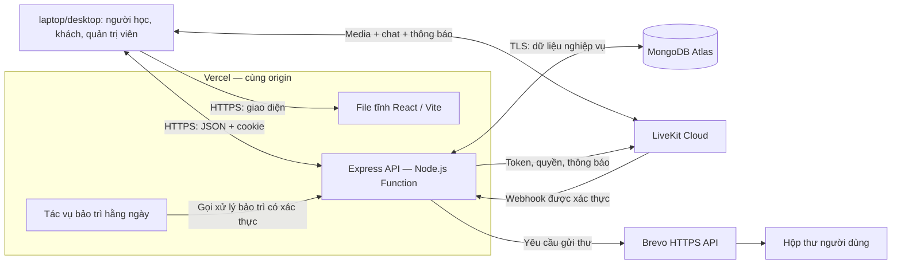
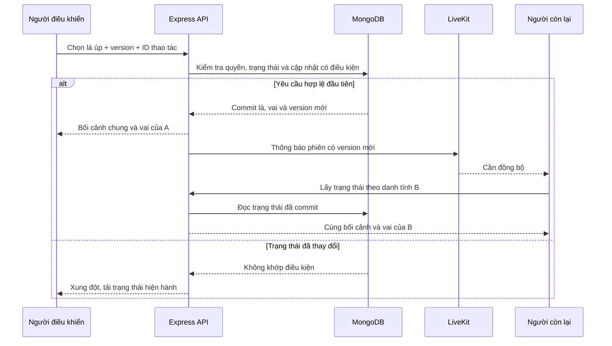

# Chiikaiwa — Kiến trúc hệ thống

| Thuộc tính | Giá trị |
|---|---|
| Phiên bản | 1.2 |
| Ngày | 06/11/2026 |
| Phạm vi | MVP cho nhóm 5 thành viên, triển khai trong 3–4 tuần |
| Cơ sở yêu cầu | Tổng quan dự án 1.0, SRS 1.1 và Product Backlog 1.0 |
| Mô hình | Frontend SPA; backend phân module, triển khai trên Vercel Functions |
| Dịch vụ | Vercel Hobby, MongoDB Atlas Free, LiveKit Cloud, Brevo HTTPS API |
| Ngân sách | Sử dụng trong hạn mức miễn phí |

## 1. Mục đích và phạm vi thiết kế

Tài liệu quy định kiến trúc ứng dụng, ranh giới module, giao tiếp, bảo mật, tính nhất quán dữ liệu và triển khai Chiikaiwa.

SRS quy định hành vi và tiêu chí nghiệm thu. UI/UX Specification quy định tương tác; Database Design quy định schema, index và transaction; API Specification quy định endpoint, DTO và mã lỗi. Tên trường trong tài liệu này biểu diễn ràng buộc kiến trúc.

Quy mô nghiệm thu: hai phòng đồng thời trên laptop/desktop. Các kiểm chứng triển khai được liệt kê tại mục 13.2.

## 2. Quyết định kiến trúc

| Mã | Quyết định | Cơ sở và hệ quả |
|---|---|---|
| ADR-01 | Dùng JavaScript cho frontend/backend; React, Vite, React Router và Tailwind CSS ở frontend. | Giữ cùng ngôn ngữ trong nhóm; React quản lý giao diện, Vite build ứng dụng, Tailwind định dạng giao diện. |
| ADR-02 | Backend Node.js/Express phân module trong một ứng dụng; không tách microservice. | Giảm giao tiếp nội bộ và khối lượng vận hành; module vẫn có ranh giới trách nhiệm rõ ràng. |
| ADR-03 | React được phục vụ dưới dạng file tĩnh; API Express chạy trên Vercel Functions, cùng origin với frontend. | Có một địa chỉ website, thuận tiện dùng cookie và định tuyến. Backend không được phụ thuộc tiến trình chạy liên tục. |
| ADR-04 | MongoDB là nguồn trạng thái nghiệp vụ; Mongoose truy cập dữ liệu. | Phòng, hàng chờ, thời hạn và tiến độ tồn tại qua lần khởi động Function; không dùng RAM làm nơi lưu duy nhất. |
| ADR-05 | LiveKit Cloud xử lý media, chat và thông báo trong phòng; backend quyết định quyền và thay đổi nghiệp vụ. | Cuộc gọi không chiếm một HTTP request kéo dài trên Vercel. Dữ liệu LiveKit không thay thế dữ liệu phòng trong MongoDB. |
| ADR-06 | Tìm bạn dùng polling; phòng dùng thông báo LiveKit kết hợp API và polling phục hồi. | Không bổ sung Socket.IO; client vẫn lấy được trạng thái khi bỏ lỡ thông báo. |
| ADR-07 | Xác thực bằng JWT trong cookie HttpOnly/Secure, kết hợp bản ghi phiên phía server. | Phiên tối đa 7 ngày; có thể thu hồi khi đăng xuất và kiểm tra tài khoản khóa. |
| ADR-08 | Gửi email đặt lại mật khẩu qua Brevo HTTPS API; liên kết hiệu lực 15 phút, dùng một lần. | Không phụ thuộc cổng SMTP. Chỉ coi tích hợp đạt khi gửi và sử dụng liên kết thành công với tài khoản thực tế. |
| ADR-09 | Cập nhật có điều kiện, phiên bản trạng thái và khóa thao tác chống lặp; dùng transaction khi thay đổi nhiều bản ghi phải nhất quán. | Bảo vệ một người–một luồng, một lần bốc–một lá, một lượt đánh giá–một cập nhật tiến độ. |
| ADR-10 | Nội dung học liệu được lưu theo bản bất biến khi đã sử dụng; định danh kiến thức nguồn ổn định. | Sửa/ẩn học liệu không phá lịch sử; cùng kiến thức vẫn dùng chung tiến độ FSRS. |
| ADR-11 | Quyền hết hạn được kiểm tra trong API; TTL và tác vụ bảo trì chỉ dọn dữ liệu. | Việc dọn chậm không kéo dài quyền khách, mã mời hoặc quyền đặt lại mật khẩu. |
| ADR-12 | FSRS-6 chạy ở backend qua thư viện tương thích, có cấu hình và bộ kiểm chứng riêng. | Client không tính lịch cuối cùng; preview và review dùng cùng thuật toán/cấu hình. |

Express được Vercel hỗ trợ dưới dạng Function với Fluid compute; frontend Vite có thể triển khai dưới dạng ứng dụng tĩnh. Việc kết hợp cùng origin cần cấu hình định tuyến và kiểm tra trên bản triển khai. [REF-01], [REF-02]

## 3. Tổng thể hệ thống



### 3.1. Ranh giới trách nhiệm

| Thành phần | Chịu trách nhiệm | Dữ liệu không được giữ làm nguồn quyết định |
|---|---|---|
| Trình duyệt | Hiển thị, nhập liệu, media, phản hồi thao tác, đếm ngược để trình bày. | Quyền, kết quả bốc, điểm quiz, lịch FSRS hoặc thời hạn do client tự khai. |
| Express | Xác thực, phân quyền, điều kiện ghép, vòng đời phiên, học liệu, ôn tập và quản trị. | Trạng thái nghiệp vụ chỉ có trong biến toàn cục hoặc bộ nhớ một Function. |
| MongoDB | Trạng thái bền, phiên bản dữ liệu, quan hệ sở hữu, thời hạn và bản ghi chống lặp. | Media và lịch sử chat. |
| LiveKit | Kết nối và truyền media/data; trạng thái thành viên media. | Quyết định bộ chủ đề, lá bài, kết quả học hoặc quyền truy cập ghi chú. |
| Brevo | Tiếp nhận và chuyển email đặt lại mật khẩu. | Quyền thay mật khẩu hoặc xác định token còn hiệu lực. |

Quyền quản trị không bao gồm quyền tham gia cuộc gọi, đọc ghi chú hoặc flashcard thủ công. Mỗi response được tạo theo danh tính đang truy cập, thay vì gửi toàn bộ document rồi ẩn trường bằng giao diện.

### 3.2. Giao tiếp

- Frontend gọi API nghiệp vụ dưới `/api/v1` theo API Specification; dùng JSON cho dữ liệu ứng dụng và cookie cho phiên xác thực. Các yêu cầu thay đổi trạng thái có kiểm tra CSRF.
- Browser kết nối LiveKit trực tiếp bằng token giới hạn phòng/thành viên. Media không đi qua Express hoặc MongoDB.
- Backend dùng LiveKit server SDK để cấp quyền, kiểm tra thành viên, thu hồi quyền và gửi thông báo trạng thái.
- Webhook LiveKit có tuyến nhận riêng, kiểm tra chữ ký trên raw body trước khi xử lý. Tuyến này không dùng cookie người học hoặc cơ chế CSRF của browser. [REF-07]
- Backend gọi Brevo bằng HTTPS; API key chỉ có trong môi trường server. Trình duyệt không gọi Brevo trực tiếp. [REF-10]

## 4. Tổ chức ứng dụng

### 4.1. Frontend

React tổ chức theo chức năng: tài khoản, tìm bạn, phòng Kaiwa, học liệu, phần đã lưu, flashcard, quiz, lịch sử và quản trị. Component dùng chung tập trung vào form, thông báo, trạng thái tải/lỗi và điều khiển phòng.

| Loại trạng thái | Nơi quản lý | Quy tắc |
|---|---|---|
| Phiên người dùng | Context và hook tài khoản | Chỉ giữ thông tin hiển thị và trạng thái đăng nhập; không đọc JWT từ cookie. |
| Dữ liệu nghiệp vụ | API client và hook theo chức năng | Response server là nguồn cập nhật; đổi phiên bản thì lấy lại dữ liệu. |
| Media | LiveKit React SDK | Vòng đời kết nối được dọn khi rời phòng; lỗi thiết bị không khóa chat. |
| Trạng thái giao diện | State cục bộ | Mở gợi ý, mặt flashcard, nội dung đang nhập không tự thay đổi dữ liệu server. |
| Đếm ngược | Đồng hồ hiển thị từ mốc server | Không dùng số đếm ở browser để quyết định còn quyền hay đã hết hạn. |

Dùng một lớp gọi API bằng Fetch để thống nhất cookie, timeout, mã lỗi và cách thử lại. Chọn/bốc/đổi vai, nộp quiz và đánh giá flashcard phải chờ server xác nhận trước khi hiển thị kết quả chính thức. Ghi chú có thể cập nhật bản nhập cục bộ nhưng phải phân biệt đang lưu, đã lưu và lỗi.

React Router xử lý điều hướng SPA. Refresh một đường dẫn giao diện trả về ứng dụng; đường dẫn API hoặc asset không tồn tại không được bị rewrite thành HTML của SPA. Không cache dữ liệu cá nhân ở CDN; xóa cache trong bộ nhớ khi đổi tài khoản hoặc lượt khách.

### 4.2. Backend

Luồng xử lý thông thường:

```text
Request → xác thực/validation → controller → service nghiệp vụ
        → repository/Mongoose → response đã lọc theo quyền
```

| Module | Trách nhiệm chính | SRS |
|---|---|---|
| Identity | Tài khoản, hồ sơ, phiên đăng nhập, mật khẩu, danh tính khách. | FR-ACC-01 đến FR-ACC-06; FR-GST-01 |
| Matchmaking | Tiêu chí, hàng chờ, xếp ứng viên, đề nghị ghép và giữ chỗ. | FR-MAT-01 đến FR-MAT-05 |
| Invitations | Mã mời, xin vào, chấp nhận, hủy và giới hạn thành viên. | FR-INV-01 đến FR-INV-03 |
| Sessions | Thành viên, vòng đời phòng, hiện diện, thời lượng, quyền LiveKit và chia sẻ màn hình. | FR-SES-01 đến FR-SES-08 |
| Scenario Practice | Chọn bộ, bàn bài, phân vai, gợi ý và đồng thuận. | FR-CAR-01 đến FR-CAR-07 |
| Learning | Kiến thức đã lưu, ghi chú, tổng kết, lịch sử và tự đánh giá. | FR-LRN-01 đến FR-LRN-07 |
| Flashcards | Bộ cá nhân, thẻ thủ công, scheduler, tiến độ và review log. | FR-FLC-01 đến FR-FLC-08 |
| Quizzes | Tạo lượt, bản câu hỏi, chấm, kết quả và làm lại. | FR-QIZ-01 đến FR-QIZ-06 |
| Content | Biên soạn, kiểm tra nội dung, xuất bản, ẩn và lưu bản học liệu. | FR-ADM-02 đến FR-ADM-04 |
| Safety & Administration | Chặn, báo cáo, khóa tài khoản và thống kê. | FR-SAF-01 đến FR-SAF-03; FR-ADM-01, FR-ADM-05, FR-ADM-06 |
| Guest Lifecycle | Giới hạn dữ liệu lượt thử, tổng kết tạm, hết quyền và dọn dữ liệu. | FR-GST-02 đến FR-GST-04 |

Module gọi service của nhau khi cần áp dụng quy tắc chung; không sao chép logic chặn, giữ chỗ hoặc hết hạn vào nhiều controller. Middleware kiểm tra quyền chung; service kiểm tra điều kiện của tài nguyên và trạng thái ngay trong thao tác ghi.

LiveKit, Brevo và FSRS được đặt sau các adapter có giao tiếp nhỏ. Đây là lớp tích hợp trong cùng backend, không phải dịch vụ độc lập.

Thống kê đếm sự kiện nghiệp vụ đã xác nhận: tài khoản, phiên bắt đầu, review đã ghi và quiz đã nộp. Không đếm request, preview hoặc phòng chờ. Nếu cần giữ số tổng sau khi xóa dữ liệu khách, chỉ lưu số tổng hợp không kèm nội dung học riêng; không giữ bản sao lịch sử khách để phục vụ thống kê.

### 4.3. Cấu trúc mã nguồn dự kiến

```text
chiikaiwa/
├── client/                 React, Router, Tailwind, hook và API client
├── server/
│   ├── app.js              Khởi tạo Express, không tự giữ tiến trình nền
│   ├── modules/            Các module nghiệp vụ
│   ├── integrations/       LiveKit, Brevo và FSRS
│   ├── middleware/         Xác thực, CSRF, validation và lỗi
│   ├── persistence/        Kết nối MongoDB, transaction và index
│   └── maintenance/        Xử lý hết hạn, dọn dữ liệu và đối soát
├── api/                    Entry point cho Vercel Functions
├── tests/                  Kiểm thử nghiệp vụ, tích hợp và end-to-end
└── scripts/                Chuẩn bị dữ liệu, sao lưu và khôi phục
```

Frontend/backend cùng repository nhưng có ranh giới dependency. Mã chứa bí mật, đáp án quiz hoặc vai chưa được cấp không được import vào frontend. Chỉ bổ sung thư viện khi phục vụ yêu cầu cụ thể.

## 5. Dữ liệu, đồng thời và tính nhất quán

### 5.1. Phân nhóm dữ liệu

| Nhóm | Nội dung | Vòng đời |
|---|---|---|
| Tài khoản và xác thực | Hồ sơ, hash mật khẩu, trạng thái, phiên đăng nhập, quyền đặt lại mật khẩu. | Tài khoản lưu bền; phiên/token có thời hạn và khả năng thu hồi. |
| Điều phối | Giữ chỗ theo danh tính, yêu cầu tìm, đề nghị ghép, mã mời, quyền vào phòng. | Tồn tại trong luồng hiện hành; kết thúc/hết hạn phải giải phóng. |
| Phiên luyện | Hai thành viên, trạng thái, bộ đã chọn, lá/vai, hiện diện, thời lượng, lý do kết thúc. | Phần lịch sử của người có tài khoản lưu bền. |
| Học liệu | Định danh nội dung, bản đã xuất bản, quan hệ chủ đề–cấp độ và trạng thái chọn mới. | Bản đã được sử dụng không sửa tại chỗ hoặc xóa phá tham chiếu. |
| Học tập cá nhân | Mục đã lưu, nguồn, ghi chú, bộ/thẻ riêng, tiến độ, review log và lượt quiz. | Theo chủ sở hữu; dữ liệu khách có vòng đời riêng. |
| Kiểm soát | Chặn, báo cáo, kết quả xử lý và số liệu tổng hợp. | Tách khỏi ghi chú, chat và dữ liệu học tạm của khách. |
| Vận hành | Khóa thao tác, webhook đã xử lý, giới hạn request, yêu cầu thu hồi media còn lỗi. | Lưu tối thiểu cho chống lặp, xử lý lỗi và bảo trì; không chứa nội dung học riêng. |

Collection và index cụ thể được đặc tả trong thiết kế database. Tất cả truy vấn dữ liệu riêng phải kèm danh tính chủ sở hữu; truy vấn phòng phải kiểm tra thành viên.

### 5.2. Các bất biến cần bảo vệ

| Bất biến | Cơ chế thiết kế |
|---|---|
| Một danh tính chỉ chiếm một luồng chờ/phòng | Một bản ghi điều phối duy nhất theo danh tính; thay đổi hai người và cặp/phòng trong transaction. |
| Hai người chỉ tạo một cặp và một phòng | Kiểm tra lại điều kiện, version và bản ghi giữ chỗ khi commit; khóa duy nhất cho quan hệ đề nghị–phòng. |
| Một bước bốc chỉ nhận một lá | Cập nhật có điều kiện trên version/trạng thái phiên; ánh xạ lá chỉ nằm ở server. |
| Một yêu cầu đồng thuận hiện hành | Lưu ID đề nghị, lá, người đề nghị và version; đối tác đồng ý đúng ID mới thực hiện. |
| Một mục đã lưu theo người và kiến thức | Unique index; thêm nguồn theo tập hợp không trùng. |
| Một tiến độ theo người và kiến thức nguồn | Khóa duy nhất tách biệt với quan hệ thuộc bộ; thẻ thủ công dùng định danh riêng. |
| Một thao tác đánh giá chỉ ghi một lần | Khóa thao tác và transaction chứa tiến độ cùng review log. |
| Một lượt quiz chỉ có một kết quả nộp | Cập nhật từ trạng thái chưa nộp sang đã nộp có điều kiện; giữ kết quả để trả lại khi retry. |

MongoDB hỗ trợ atomic update ở mức document; điều kiện update phải chứa trạng thái/giá trị kỳ vọng. Những thay đổi nhiều document cần cùng thành công dùng transaction. Unique index và transaction giải quyết các ràng buộc khác nhau, không thay thế lẫn nhau. [REF-04], [REF-05]

Giữ transaction ngắn, chỉ thực hiện thao tác database. Không gửi email, gọi LiveKit hoặc chờ người dùng trong transaction. Khi driver thử lại transaction, không được tạo tác dụng bên ngoài lặp lại.

Khóa tài khoản, tạo chặn và cấp phòng phải cùng tham gia cơ chế tranh chấp dữ liệu: cập nhật version kiểm soát của các danh tính liên quan và kiểm tra lại trong transaction cấp phòng. Chỉ đọc danh sách chặn trước khi ghi mà không tạo xung đột ghi có thể cho phép một phòng được cấp đồng thời với thao tác chặn.

### 5.3. Thao tác lặp và trạng thái cũ

Client tạo ID cho một ý định thay đổi và giữ ID đó khi thử lại sau timeout. Server gắn ID với người gửi, loại thao tác, tài nguyên và nội dung yêu cầu. Cùng ID với nội dung khác bị từ chối. Không dùng ID từ client để bỏ qua kiểm tra danh tính, thành viên hoặc thời hạn.

Nếu thao tác đã commit, trả kết quả tương ứng sau khi kiểm tra quyền hiện tại. Với dữ liệu nhạy cảm có thể thay đổi như vai, chỉ trả trạng thái hiện hành được phép xem; không phát lại vai cũ từ cache chống lặp. Nếu version đã thay đổi do thao tác khác, trả xung đột và yêu cầu tải lại, không tự áp ý định lên lá tiếp theo.

Unique index, version và khóa nghiệp vụ tiếp tục bảo vệ dữ liệu khi bản ghi chống lặp đã được dọn. Không dựa duy nhất vào một cache có thời hạn để ngăn đánh giá hoặc nộp bài lặp.

### 5.4. Học liệu và lịch sử

Một mục kiến thức có định danh nguồn ổn định và các bản nội dung. Khi xuất bản thay đổi, tạo bản mới; bản cũ đã sử dụng tiếp tục tồn tại. Phiên tham chiếu bộ/tình huống đúng bản; mục đã lưu ghi được nguồn và bản từng gặp; lượt quiz giữ bản câu hỏi, đáp án và giải thích lúc tạo.

Trạng thái ẩn chỉ ngăn chọn mới. Người có quyền lịch sử vẫn truy cập được nội dung đã sử dụng. Tiến độ FSRS khóa theo người và định danh nguồn, không theo bản nội dung, bộ hoặc phiên. Thẻ thủ công không tự được hợp nhất bằng cách so sánh nội dung chữ.

## 6. Xác thực, phân quyền và bảo mật

### 6.1. Phiên người có tài khoản

- JWT chỉ mang định danh cần thiết như người dùng, phiên, thời điểm cấp/hết hạn và thông tin kiểm tra issuer/audience; không chứa email hoặc dữ liệu học tập.
- Cookie dùng `HttpOnly`, `Secure`, `SameSite=Lax`, phạm vi host của website và `Path=/`. Trên môi trường HTTP local, cấu hình cookie phục vụ phát triển phải tách biệt với production.
- Phiên có thời hạn tuyệt đối tối đa 7 ngày từ lúc đăng nhập. JWT và bản ghi phiên cùng hết hạn; không tự kéo dài thời hạn khi refresh trang.
- Mọi API được bảo vệ kiểm tra chữ ký, thuật toán cho phép, thời hạn JWT, bản ghi phiên còn hiệu lực và tài khoản đang hoạt động. Không tin trạng thái tài khoản chỉ vì token từng được cấp hợp lệ.
- Đăng xuất thu hồi bản ghi phiên hiện tại và xóa cookie. Khóa tài khoản làm các request tiếp theo bị từ chối; đổi/đặt lại mật khẩu thu hồi các phiên cũ để tránh tiếp tục dùng quyền đã cấp trước đó.
- Không cần cơ chế refresh token riêng cho MVP. Khi hết phiên, người dùng đăng nhập lại; response dữ liệu riêng dùng chính sách không cache.

Cookie HttpOnly giúp hạn chế JavaScript đọc token, không thay thế chống XSS hoặc CSRF. Thiết kế phiên và kiểm tra thời hạn tham khảo hướng dẫn OWASP. [REF-12]

### 6.2. Danh tính khách và quyền LiveKit

Khách có mã nhận diện tạm ngẫu nhiên trong cookie HttpOnly/Secure riêng, với bản ghi phía server. Dữ liệu này không biến khách thành tài khoản người học. Mỗi request suy ra đúng lượt thử từ danh tính được xác thực; không nhận `guestId` tùy ý làm quyền truy cập.

Token LiveKit tách khỏi token đăng nhập, chỉ có quyền vào đúng phòng dưới đúng identity. Không có quyền quản trị phòng, ghi hình hoặc tham gia phòng khác. Quyền publish ban đầu chỉ gồm nguồn camera/mic và chat cần thiết; chia sẻ màn hình được cấp theo mục 8.3. Token media được trả cho SDK sử dụng trong bộ nhớ, không ghi vào logs hoặc lưu lâu dài ở trình duyệt. [REF-08]

### 6.3. Bảo vệ API

| Rủi ro | Biện pháp |
|---|---|
| CSRF | Kiểm tra Origin theo danh sách cho phép, CSRF token gắn với phiên cho thao tác thay đổi; dùng cùng origin. SameSite không phải biện pháp duy nhất. |
| XSS | Render văn bản an toàn, không đưa nội dung chat/ghi chú vào HTML thô; kiểm tra trường dữ liệu được phép. |
| Truy cập bằng ID người khác | Truy vấn theo người sở hữu/thành viên; kiểm tra lại tại service cho đọc, ghi, xuất kết quả và xem lịch sử. |
| NoSQL injection | Kiểm tra kiểu dữ liệu, chỉ nhận trường được khai báo; không truyền object/filter từ client trực tiếp vào truy vấn MongoDB. |
| Dò mật khẩu/mã mời, lạm dụng email | Giới hạn request theo IP và danh tính phù hợp bằng bộ đếm atomic có TTL trong MongoDB; trả lỗi có thời gian thử lại. |
| Lộ bí mật | Secret chỉ ở backend; JWT secret, URI database, LiveKit secret, Brevo key không dùng tiền tố biến build công khai. |
| Quản trị vượt quyền | Admin chỉ quản lý học liệu, tài khoản, báo cáo và thống kê; không có API đọc ghi chú/thẻ thủ công hoặc cấp quyền nghe gọi cho Admin. |

Mật khẩu được băm bằng thư viện chuyên dụng có salt; tham số băm được đo trên runtime mục tiêu. Quy tắc độ dài đầu vào, ngưỡng rate limit và giới hạn payload phải được ghi trong cấu hình/API và kiểm thử trước triển khai. Không dùng rate limiter trong RAM làm biện pháp duy nhất vì các Function có thể chạy đồng thời trên nhiều instance.

### 6.4. Đặt lại mật khẩu

1. Nhận yêu cầu theo email và áp dụng giới hạn request. Phản hồi công khai không xác nhận email có tài khoản hay không.
2. Với tài khoản phù hợp, tạo token ngẫu nhiên có độ khó đoán đủ cao; database chỉ lưu hash, chủ sở hữu, thời điểm hết hạn và trạng thái sử dụng. Hiệu lực là 15 phút từ khi cấp.
3. Tạo URL từ origin cấu hình của website, không lấy tùy ý từ header Host hoặc URL do client gửi. Gửi qua Brevo HTTPS API.
4. Khi người dùng gửi mật khẩu mới, kiểm tra hash/thời hạn/trạng thái; cập nhật mật khẩu, tiêu thụ token và thu hồi các phiên cũ trong transaction. Token đặt lại mật khẩu khác của tài khoản cũng bị vô hiệu.
5. Không tự đăng nhập sau đặt lại mật khẩu; người dùng đăng nhập bằng mật khẩu mới.

Brevo tiếp nhận yêu cầu không đồng nghĩa thư đã vào inbox. Nếu không nhận phản hồi từ dịch vụ, không đổi mật khẩu hoặc ghi chắc chắn thư đã gửi. Thông báo lỗi ở mức dịch vụ không được tiết lộ sự tồn tại của một email; thông tin lỗi gửi chi tiết chỉ dùng cho vận hành, không chứa token hoặc nội dung liên kết.

## 7. Ghép bạn, mã mời và thời hạn

### 7.1. Ghép tự động

Frontend gửi tiêu chí; backend xác thực và lưu một yêu cầu tìm kèm bản ghi giữ chỗ. Một lần tìm hoặc đồng bộ hàng chờ kích hoạt việc xét ứng viên, không cần worker giữ vòng lặp vô hạn.

Service lọc điều kiện hai chiều, kiểm tra chặn/trạng thái và xếp theo BR-01 đến BR-03. Khi có ứng viên, transaction kiểm tra lại cả hai còn tìm, version hồ sơ/tiêu chí và bản ghi điều phối còn phù hợp, rồi tạo một đề nghị có hạn 30 giây. Hai request cạnh tranh không thể giữ cùng một người cho hai cặp.

Hai lần chấp nhận cập nhật đề nghị có điều kiện. Lần làm đủ hai xác nhận tạo đúng một quyền phòng. Hủy/từ chối/hết hạn giải phóng cả hai và không tự tìm lại. Sau hai phút, API trả thông tin để frontend hiện các lựa chọn của BR-06; sửa tiêu chí tạo lượt tìm mới.

Polling chỉ hoạt động khi người dùng còn ở luồng chờ. Bản ghi tìm có dấu hiệu liên lạc và lease kỹ thuật để xử lý tab bị đóng hoặc mất mạng mà request hủy không tới nơi. Lease hết hạn làm yêu cầu không còn đủ điều kiện được ghép; khi trở lại phải nhận trạng thái mới, không âm thầm ghép bằng yêu cầu đã mất hiệu lực. Chu kỳ và ngưỡng lease được khóa trong cấu hình khi kiểm thử mất mạng và tab nền.

### 7.2. Phòng mời

Mã mời được sinh ngẫu nhiên bằng nguồn ngẫu nhiên an toàn, tránh mã tuần tự; server kiểm tra không trùng mã còn hiệu lực. Mã có hạn 10 phút và chỉ định danh yêu cầu xin vào, không phải token gọi.

Người tạo chấp nhận một yêu cầu trong transaction: kiểm tra còn chỗ, mã chưa dùng/hết hạn, hai danh tính chưa bận, tài khoản hoạt động và không bị chặn. Chấp nhận thành công gắn đúng hai thành viên và đóng mã với người mới. Không áp bộ lọc ghép tự động cho phòng mời.

Tạo hoặc chuyển cách tìm phải cập nhật cùng bản ghi điều phối theo danh tính. Chưa đủ hai kết nối thì chỉ là trạng thái vào phòng; chưa tăng số phiên đã luyện. Lỗi khởi tạo có đường hủy, và mất liên lạc ở bước vào phòng được giải phóng theo giới hạn phục hồi của SRS.

### 7.3. Thời gian trên môi trường serverless

| Mốc | Dữ liệu quyết định | Khi xử lý |
|---|---|---|
| Đề nghị ghép 30 giây | Thời điểm tạo và hết hạn | Mọi lần đọc/chấp nhận/hủy đề nghị. |
| Gợi ý sau 2 phút | Thời điểm bắt đầu lượt tìm | Khi trả trạng thái chờ; không tự nới bộ lọc. |
| Mã mời 10 phút | Thời điểm hết hạn của mã | Khi xin vào, chấp nhận hoặc chuyển luồng. |
| Chọn bộ 60 giây hoạt động | Phần thời gian còn lại và mốc bắt đầu đoạn có đủ hai người | Khi đồng bộ/chọn bộ hoặc xử lý hiện diện. |
| Phục hồi tối đa 5 phút | Mốc server xác định mất kết nối và hạn phục hồi | Webhook, đồng bộ phòng, cấp token hoặc yêu cầu vào lại. |
| Ôn thử 15 phút | Thời điểm kết thúc hợp lệ cộng 15 phút | Mọi API dữ liệu khách, kể cả dữ liệu chưa bị xóa vật lý. |

Hàm xử lý hết hạn dùng cùng logic ở API, webhook và bảo trì. Khi phát hiện muộn, kết thúc logic tại mốc hết hạn đã tính, không lấy thời điểm chạy bảo trì làm mốc để kéo dài ôn thử hoặc thời lượng phiên. Trước khi cấp phòng mới cho một danh tính, xử lý giữ chỗ cũ đã hết hạn trong cùng quá trình kiểm tra.

Không giữ request chờ 30 giây/5 phút; không dùng `setTimeout` hoặc `setInterval` phía Function để bảo đảm các mốc trên. Browser có thể dùng timer để hiển thị và gọi đồng bộ, nhưng server luôn quyết định tính hợp lệ.

## 8. Phòng Kaiwa và đồng bộ tình huống

### 8.1. Cấp quyền, hiện diện và vòng đời

Tên phòng LiveKit được suy ra từ định danh phiên không tái sử dụng; identity media ánh xạ về danh tính thành viên của phiên. Backend không cấp identity từ giá trị tùy ý của client. Cấu hình phòng tối đa hai thành viên và giữ thêm ràng buộc hai thành viên trong database.

Webhook sau xác thực được ghi nhận theo ID sự kiện để chống xử lý trùng. Sự kiện tham gia có kết nối media hợp lệ mới dùng xác nhận hiện diện; sự kiện phòng được tạo hoặc người đầu tiên vào không đồng nghĩa phiên đã bắt đầu. Chỉ chuyển sang chọn bộ khi cả hai thành viên đã kết nối.

LiveKit không bảo đảm giao webhook thành công trong mọi trường hợp. Backend đối soát bằng Room Service API khi phát hiện trạng thái không khớp, khi phục hồi hoặc khi cấp quyền vào lại. Sự kiện cũ phải kiểm tra phòng, identity và lần kết nối trước khi áp dụng, tránh một sự kiện rời cũ làm ngắt người vừa kết nối lại. [REF-07], [REF-09]

Mất kết nối tạo hạn phục hồi, đóng đoạn thời gian có đủ hai người và tạm dừng thao tác chung. Vào lại trước hạn khôi phục đúng version và phần thời gian chọn bộ còn lại. Thời lượng được tích lũy theo các đoạn có đủ hai kết nối, xử lý sự kiện lặp không cộng lần thứ hai. Nếu thiếu bằng chứng hiện diện do lỗi dịch vụ, không suy đoán người dùng vẫn đang luyện; đối soát và ghi nhận khoảng chưa xác định trong logs vận hành.

Rời chủ động hoặc chặn kết thúc trạng thái nghiệp vụ trước, rồi backend thu hồi quyền hai thành viên và đóng phòng media. LiveKit Cloud hỗ trợ thu hồi token khi loại participant; chỉ xóa cookie hoặc ngừng cấp token mới không đủ để chặn token đã cấp. [REF-09]

Nếu lệnh thu hồi lỗi, lưu trạng thái cần xử lý lại trên phiên, từ chối mọi thao tác nghiệp vụ mới và thử lại qua luồng đồng bộ/bảo trì. Webhook tham gia phòng đã kết thúc kích hoạt loại participant. Không cấp token cho phiên đã kết thúc hoặc tái dùng tên phòng đó. Việc ngắt media có thể chậm khi dịch vụ ngoài không phản hồi; trường hợp này phải được ghi và kiểm thử riêng.

### 8.2. Chọn bộ, bốc và đổi trạng thái

Backend random `controllerKey` khi phiên bắt đầu và giữ trong MongoDB. Chọn bộ, bốc và lấy quyền dùng CAS trên version phiên. Lấy quyền không cần người giữ quyền duyệt; chọn/bốc kiểm tra controllerKey trong điều kiện ghi. Sau commit, thông báo version mới để cả hai đồng bộ. Reconnect giữ quyền; khi thiếu kết nối hoặc phiên đã ended, từ chối lấy quyền/chọn/bốc. Đồng thuận đổi vai/bỏ qua/hoàn thành độc lập với quyền điều khiển.



Bàn bài gửi cho client chỉ có ID vị trí, trạng thái úp/đã dùng và dữ liệu hiển thị cần thiết. Ánh xạ vị trí–tình huống, nội dung lá chưa bốc và vai đối tác không có trong response. Kho học liệu độc lập chỉ cung cấp kiến thức được phép xem, không mở một đường API khác để đọc vai riêng của phiên.

Đổi vai, bỏ qua và hoàn thành/chuyển tiếp dùng một đề nghị đồng thuận có ID gắn với lá/version. Người còn lại phải đồng ý đúng đề nghị; gửi đề nghị khác không tính là đồng ý. Khi mất kết nối, đề nghị chưa hoàn tất bị vô hiệu để không áp dụng sau phục hồi. Lá bỏ qua/hoàn thành không quay lại bàn; hết bài vẫn giữ gọi/chat.

Backend commit trước rồi gửi thông báo nhẹ gồm định danh phiên và version, không phát vai, ghi chú hoặc đáp án. Gửi thông báo lỗi không rollback thao tác đã commit. Client lấy lại API khi vào phòng, reconnect, phát hiện version lệch, quay lại tab hoặc theo polling phục hồi. Thông báo do client giả mạo chỉ có thể gây yêu cầu đồng bộ được giới hạn tần suất, không thay đổi trạng thái server.

Chu kỳ polling khởi đầu là 2 giây trong lúc chờ hoặc đang ở phòng; không tạo request chồng nhau. Khi lỗi, giảm tần suất và hiển thị mất đồng bộ, tạm khóa thao tác chung cho tới khi lấy được trạng thái. Giá trị này là cấu hình kỹ thuật cần đo theo NFR-03/NFR-04, không phải bảo đảm mọi thay đổi sẽ đến trong đúng 2 giây.

### 8.3. Chat, thiết bị và chia sẻ màn hình

Camera/mic có thể tắt hoặc bị từ chối. Giao diện vẫn cung cấp chat/rời phòng. Chat đi qua LiveKit, chỉ giữ trong bộ nhớ của phiên trên client; không lưu vào MongoDB, localStorage hoặc lịch sử. Nội dung chat được render như văn bản.

Chia sẻ màn hình phải được điều phối ở server. Phiên lưu danh tính đang giữ quyền chia sẻ; xin quyền bằng cập nhật có điều kiện. Backend chỉ cấp quyền publish nguồn screen share cho người đã giữ chỗ, không cấp sẵn cho cả hai token.

Khi dừng hoặc mất kết nối, thu hồi quyền nguồn màn hình của người cũ trước khi cấp cho người mới. Nếu thao tác LiveKit thất bại, chưa cấp quyền cho người thứ hai và thông báo thử lại. Request xin quyền nhưng browser từ chối phải trả chỗ; sự kiện track và đối soát xử lý trường hợp client không gửi được thông báo dừng. Quyền camera/mic không bị thay đổi ngoài ý muốn khi cập nhật quyền chia sẻ.

Mỗi lần cấp/thu hồi gắn với version yêu cầu chia sẻ. Sau phản hồi từ LiveKit, kiểm tra quyền giữ chỗ còn hiện hành; nếu yêu cầu đã bị hủy hoặc phiên đã kết thúc thì thu hồi quyền vừa cấp. Không coi một phản hồi đến muộn là quyền chia sẻ của trạng thái mới.

## 9. Học tập, flashcard và quiz

### 9.1. Lưu kiến thức, ghi chú và tổng kết

Lưu một mục dùng định danh nguồn, danh tính chủ sở hữu và nguồn phiên/tình huống nếu có. Server kiểm tra nguồn đó thuộc nội dung người dùng được phép xem. Lưu ngoài cuộc gọi không tạo phiên giả. Một mục có nhiều nguồn nhưng chỉ một mục cá nhân; bỏ lưu không xóa tiến độ.

Ghi chú tự lưu theo người và phiên bằng version có điều kiện. Khi nhiều tab sửa, không âm thầm ghi đè bản mới bằng bản cũ; client giữ phần nhập chưa lưu và thông báo cần tải lại/kiểm tra. Tổng kết đọc dữ liệu chung của phiên kết hợp dữ liệu riêng theo chủ sở hữu. Tự đánh giá không thay đổi cấp độ, kết quả quiz hoặc lịch ôn.

Gợi ý dùng cùng nguồn kiến thức của tình huống nhưng hiển thị trong vùng phụ riêng trên mỗi giao diện phòng. Mỗi người tự mở/đóng, cuộn và xem từ vựng/ngữ pháp; lưu kiến thức và ghi chú chỉ tác động dữ liệu của mình. Các thao tác này không yêu cầu quyền điều khiển và không chuyển màn hình đối tác.

### 9.2. FSRS

Adapter FSRS nhận trạng thái hiện tại, thời điểm server, rating và cấu hình. Trả trạng thái mới cùng lịch sử đánh giá; service mới là nơi kiểm tra quyền và commit. Dùng `ts-fsrs@6.0.0` với mô hình FSRS-6 trên Node.js 24.x. Chọn rõ `FSRS6Model` qua `defineScheduler` và `dateChrono`; không dùng mặc định FSRS-7. Cấu hình chi tiết được chốt tại SRS mục 6.2. [REF-13], [REF-14]

Các policy đăng ký theo thứ tự: retention → statistics → scheduled days → learning steps → maximum interval → monotonic interval. Không đăng ký fuzz middleware hoặc optimizer. Adapter không ghi database; preview tính qua cùng luồng review với ba rating, service tính lại tại thời điểm commit thực tế.

Cấu hình thuật toán tuân SRS mục 6 và được lưu bất biến trong `scheduler_configs` theo Database Design mục 8.4. Preview và review dùng cùng cấu hình; không phụ thuộc mặc định của thư viện.

Preview không ghi dữ liệu. Review đọc đúng version, tính lịch tại server rồi ghi tiến độ và review log trong transaction có khóa chống lặp. Khi xung đột phải tải trạng thái mới; không tự tính lại để biến cùng một lần nhấn thành lượt ôn thứ hai. Mỗi tiến độ ghi nhận cấu hình/phiên bản thuật toán phục vụ tái lập.

Học toàn bộ chủ đề, phần đã lưu và bộ cá nhân truy cùng tiến độ nguồn. Thẻ thủ công có khóa riêng. Danh sách đến hạn so sánh với thời gian server; không cần cron tạo lại lượt ôn. Không đánh giá thì không cập nhật FSRS, kể cả khi xem đáp án hoặc làm quiz.

### 9.3. Quiz

Khi tạo lượt, server chọn tối đa năm câu không trùng từ ngân hàng bộ chủ đề–cấp độ và lưu bản câu hỏi/đáp án chuẩn. Response trước nộp chỉ chứa phần làm bài. Ngân hàng rỗng không tạo lượt rỗng; ít câu thì lấy số câu hiện có.

Nộp bài được chấm phía server theo BR-22; chỉ chuyển một lần sang đã nộp. Kết quả giữ số đúng, tổng câu, câu trả lời và giải thích theo bản đã dùng. Request nộp lặp trả lại kết quả đã lưu; làm lại có lượt mới. Quiz mở từ tổng kết có nguồn phiên được kiểm tra, quiz độc lập không tạo nguồn phiên giả. Không có thao tác tự động đổi danh sách đã lưu hoặc tiến độ FSRS.

## 10. Dữ liệu khách và bảo trì

### 10.1. Hết quyền và xóa dữ liệu

Mỗi lượt khách có phạm vi phòng và thời điểm hết quyền. Trong phiên, khách dùng các service học tập thông qua cùng kiểm tra nghiệp vụ nhưng với chủ sở hữu tạm. Dữ liệu học tạm được lưu tách khỏi phần lịch sử của người có tài khoản.

Khi phiên kết thúc, tính hạn khách từ thời điểm kết thúc logic cộng 15 phút. Trước khi đọc/ghi bất kỳ ghi chú, mục lưu, quiz hoặc tiến độ tạm nào, server xử lý trạng thái phiên và kiểm tra hạn này. Cookie còn tồn tại hoặc document chưa bị xóa không có nghĩa còn quyền.

Các document học tạm mang định danh lượt và `purgeAt` để dọn bằng TTL; `expiresAt` trên lượt khách quyết định thời hạn truy cập, theo Database Design mục 2.1 và 12.2. Thao tác kết thúc ghi nhận yêu cầu dọn và cập nhật thời hạn cho các nhóm dữ liệu liên quan; tác vụ bảo trì sửa các trường hợp cập nhật chưa hoàn tất. TTL không tự xóa dây chuyền các collection tham chiếu, nên phải kiểm kê đầy đủ ghi chú, mục lưu, tiến độ, review log, quiz và receipt của lượt khách; danh sách cleanup đầy đủ tại Database Design mục 12.2.

MongoDB không bảo đảm xóa vật lý đúng ngay thời điểm TTL hết hạn. Quyền phải được kiểm tra tại API độc lập với tiến trình xóa. [REF-06]

Không gắn TTL của khách lên document lịch sử chung làm mất dữ liệu người học. Phần lịch sử của tài khoản hiển thị đối tác là Khách; thông tin cần cho báo cáo được tách riêng và không chứa nội dung học riêng. Đăng ký tài khoản không chuyển chủ sở hữu dữ liệu thử.

### 10.2. Tác vụ bảo trì

Thiết kế dùng một tác vụ bảo trì hằng ngày, có xác thực server-to-server, xử lý theo lô giới hạn:

- Kết thúc logic và giải phóng bản ghi điều phối đã hết hạn nhưng chưa được cập nhật.
- Đối soát phiên còn trạng thái mở với LiveKit; hoàn tất thu hồi media đang lỗi.
- Hoàn thiện dấu hết hạn và dọn dữ liệu khách, token dùng một lần, bộ đếm rate limit hoặc metadata chống lặp đã đủ điều kiện xóa.
- Ghi số lượng xử lý/lỗi và con trỏ tiếp tục nếu một lần chạy chưa hết dữ liệu.

Vercel Hobby giới hạn mỗi lịch cron ở mức một lần mỗi ngày, không bảo đảm đúng phút chạy. Tác vụ này chỉ xử lý dữ liệu tồn đọng; không chịu trách nhiệm cho thời hạn 30 giây, 60 giây, 5 phút hoặc hết quyền khách. Cron chạy lặp không được nhân đôi kết quả, và thất bại không mở lại quyền đã hết. [REF-03]

Nếu cả hai client đã đóng và không còn request, bản ghi kết thúc vật lý có thể được cập nhật muộn. Khi API hoặc bảo trì truy cập lại, phải dùng mốc sự kiện/thời hạn đã lưu để kết thúc logic, không cộng thời gian vắng mặt vào hoạt động. Mất webhook cần đối soát; không tạo số phút luyện bằng cách lấy toàn bộ thời gian từ lúc bắt đầu tới lúc cron chạy.

## 11. Triển khai và vận hành

### 11.1. Mô hình triển khai

Một Vercel project phục vụ build Vite và tuyến `/api` tới Express Function. SPA fallback áp dụng sau tuyến API/assets. Express được export qua entry point phù hợp với Vercel; khi phát triển local có thể dùng entry point lắng nghe cổng riêng. Kiểm tra kết hợp build tĩnh và Function bằng bản triển khai nhỏ trước khi tích hợp toàn bộ ứng dụng.

Sử dụng địa chỉ HTTPS do Vercel cấp, chưa cần tên miền riêng. Một thành viên phụ trách project triển khai và cấu hình secret; các thành viên cộng tác qua source code và review, không chia sẻ mật khẩu dịch vụ. Kiểm tra giới hạn cộng tác và tích hợp Git của tài khoản Hobby trước khi chọn quy trình deploy; không mặc định có năm ghế quản trị miễn phí. Gói Hobby dành cho mục đích cá nhân, phi thương mại và chịu hạn mức tài nguyên. [REF-15]

Chọn region Function gần người dùng mục tiêu và gần cluster MongoDB trong phạm vi gói miễn phí. Kết nối Mongoose được tái sử dụng khi instance còn sống, với pool giới hạn; instance mới có thể tạo kết nối mới. Không mở/đóng connection ở mọi request, không lưu dữ liệu lên filesystem Function để giữ qua lần chạy.

Atlas cần IP access list cho nguồn kết nối. Khi cấu hình phải kiểm tra đường ra mạng thực tế của Vercel, không mặc định IP từ một lần chạy là IP cố định. Nếu môi trường yêu cầu mở dải nguồn rộng, ghi rõ cấu hình đó, dùng TLS và tài khoản database riêng chỉ có quyền trên database ứng dụng; không coi access list là cơ chế xác thực. Kiểm tra kết nối từ instance mới thuộc AV-02. [REF-19]

### 11.2. Runtime và dependency

| Thành phần | Quy tắc |
|---|---|
| Node.js | Khai báo nhánh 24.x ở cấu hình project và package; ghi nhận phiên bản thực tế khi build/chạy. |
| JavaScript | Dùng ES modules nhất quán; không trộn ESM/CommonJS theo ví dụ rời rạc. |
| Frontend | React, Vite, React Router, Tailwind CSS và LiveKit React SDK tương thích với nhau. |
| Backend | Express, Mongoose, thư viện JWT/băm mật khẩu, LiveKit server SDK và adapter FSRS. |
| Khóa dependency | Commit lockfile và cài đặt tái lập; không để build tự lấy bản mới nhất ngoài lockfile. |
| FSRS | `ts-fsrs@6.0.0`, chọn rõ FSRS-6; cấu hình làm tròn, thời gian, chuyển bước và khoảng tối đa theo SRS mục 6.2. Nâng dependency phải kiểm chứng lại. |

Vercel cho chọn nhánh major Node.js và có thể cập nhật minor/patch của runtime. Vì vậy, khóa dependency không đồng nghĩa khóa toàn bộ runtime managed ở một patch cố định. Ghi nhận phiên bản thực tế khi kiểm thử và sau thay đổi môi trường. [REF-14]

### 11.3. Cấu hình và bí mật

| Nhóm | Cấu hình cần quản lý |
|---|---|
| Website | Origin chính thức, prefix API, origin phát triển/preview được phép. |
| Database | URI, tên database, giới hạn pool; quyền tài khoản database tối thiểu cần thiết. |
| Xác thực | JWT secret, issuer/audience, hạn phiên 7 ngày, hạn reset 15 phút, cấu hình cookie và CSRF. |
| LiveKit | URL project, API key/secret, endpoint webhook, thời hạn token kỹ thuật và quyền publish. |
| Brevo | API key, tên/địa chỉ gửi đã được chấp nhận, timeout gọi API. |
| Bảo trì | Secret gọi nội bộ, kích thước lô và chính sách thử lại. |
| Hiệu năng | Chu kỳ polling, lease tìm kiếm, timeout đối soát, rate limit và giới hạn request. |

Development dùng dữ liệu thử riêng. Preview không tự trỏ vào database hoặc project LiveKit đang demo; nếu dùng chung tài khoản dịch vụ thì phải tách database và namespace phòng. Webhook và email reset phải trỏ đúng môi trường. Biến frontend chỉ chứa dữ liệu công khai; API key/secret không nằm trong bundle.

### 11.4. Hạn mức và cold start

Frontend được phục vụ dưới dạng file tĩnh. API có thể gặp cold start, độ trễ kết nối database và giới hạn tài nguyên. Đo riêng các trường hợp này khi kiểm thử trên Vercel Fluid compute. [REF-16]

Trước demo kiểm tra hạn mức Vercel, Atlas, LiveKit và Brevo. Không tự nâng gói hoặc mua tài nguyên. Tối ưu bằng request ngắn, index phù hợp, pool giới hạn, không polling khi đã rời luồng, không tải lại toàn bộ bộ thẻ khi chỉ đổi version phòng. Ngưỡng nghiệm thu giữ theo NFR-02 đến NFR-04, đo trên bản online với cold start được ghi riêng.

Brevo được dùng để gửi email giao dịch. Gói miễn phí có hạn mức gửi; với địa chỉ gửi miễn phí/chưa xác thực tên miền, Brevo mô tả cơ chế thay địa chỉ gửi như biện pháp tạm. Không khẳng định tích hợp hoạt động chỉ vì đã đăng ký tài khoản. Phải xác minh quyền gửi và thử nhận thư, kể cả kiểm tra thư rác, trước khi nghiệm thu FR-ACC-04. [REF-11]

### 11.5. Logs, sao lưu và phục hồi

Logs gồm mã request, loại thao tác, tài nguyên định danh tối thiểu, mã lỗi, thời gian xử lý và trạng thái gọi dịch vụ. Không log mật khẩu, token, reset URL, nội dung ghi chú, chat hoặc vai riêng. Ghi lỗi xung đột, webhook không xác thực, thu hồi LiveKit thất bại và dọn dữ liệu tồn đọng để chẩn đoán.

Chuẩn bị bản sao lưu dữ liệu bền trước demo và trước thay đổi dữ liệu quan trọng; lưu ngoài runtime Function bằng công cụ database từ máy được cấp quyền. Không sao lưu dữ liệu khách đã hết hạn như một cách lưu lịch sử học tạm. Bản sao lưu phải được kiểm soát truy cập, không đưa lên repository công khai.

Khôi phục vào database thử riêng, kiểm tra phiên, ghi chú, tiến độ và kết quả quiz trước khi dùng cho phục hồi thực tế. Sau restore phải vô hiệu phiên xác thực cũ và chạy xử lý hết hạn trước khi cho ứng dụng phục vụ, tránh khôi phục lại quyền đã bị thu hồi. Rollback bản build không tự rollback database; thay đổi schema cần giữ tương thích với bản được phép quay lại.

## 12. Lỗi và phục hồi

| Tình huống | Xử lý |
|---|---|
| API timeout, chưa biết đã commit hay chưa | Giữ ID thao tác, đọc lại hoặc thử cùng ID; không tạo ý định mới chỉ vì mất response. |
| MongoDB không sẵn sàng | Từ chối thao tác cần kiểm tra/ghi dữ liệu, thông báo thử lại; không chuyển sang quyết định bằng RAM/client. |
| LiveKit thông báo thất lạc | Polling/API lấy trạng thái mới; version cũ không ghi đè version mới. |
| Media còn kết nối nhưng API lỗi | Cho biết mất đồng bộ và tạm dừng thao tác nghiệp vụ; không báo bốc/lưu thành công. |
| Client mất kết nối | Vào lại theo hạn 5 phút và dữ liệu server; không suy luận rời chủ động chỉ từ việc đóng socket. |
| Webhook trùng hoặc đến muộn | Kiểm tra ID, lần kết nối và trạng thái hiện hành; không tăng thời lượng hoặc kết thúc lần nữa. |
| Hai thao tác bốc/đổi cùng lúc | Một cập nhật hợp lệ được ghi; bên còn lại nhận xung đột và đồng bộ. |
| Không gửi được email | Không thay mật khẩu; phản hồi công khai không tiết lộ email tồn tại; ghi lỗi dịch vụ và cho thử lại có giới hạn. |
| Không thu hồi được media | Khóa trạng thái nghiệp vụ, ghi việc cần thử lại, đối soát/thu hồi tiếp; không coi thao tác bên ngoài đã thành công. |
| Bảo trì hoặc TTL chậm | API vẫn từ chối quyền hết hạn; lần bảo trì tiếp theo tiếp tục phần còn lại. |
| Hết hạn mức miễn phí | Thông báo chức năng bị ảnh hưởng; dừng thao tác không thể thực hiện, không tự phát sinh chi phí. |

## 13. Truy vết và kiểm chứng kiến trúc

### 13.1. Truy vết phạm vi

| Phạm vi SRS | Thiết kế | Backlog |
|---|---|---|
| FR-ACC-01 đến FR-ACC-06 | Mục 4, 6; ADR-07, ADR-08 | PB-02 đến PB-04 |
| FR-MAT-01 đến FR-MAT-05; FR-INV-01 đến FR-INV-03 | Mục 5, 7; ADR-04, ADR-06, ADR-09 | PB-08, PB-25, PB-26 |
| FR-GST-01 đến FR-GST-04 | Mục 6.2, 10; ADR-11 | PB-23, PB-24 |
| FR-SES-01 đến FR-SES-08 | Mục 7.3, 8; ADR-05, ADR-06 | PB-09 đến PB-11 |
| FR-CAR-01 đến FR-CAR-07 | Mục 5.2, 8.2; ADR-09 | PB-12 đến PB-14 |
| FR-LRN-01 đến FR-LRN-07 | Mục 5.4, 9.1; ADR-10 | PB-07, PB-15 đến PB-17 |
| FR-FLC-01 đến FR-FLC-08 | Mục 5.2, 9.2; ADR-12 | PB-18 đến PB-20 |
| FR-QIZ-01 đến FR-QIZ-06 | Mục 5.4, 9.3 | PB-21, PB-22 |
| FR-SAF-01 đến FR-SAF-03 | Mục 4.2, 5.2, 6, 8.1 | PB-27, PB-28 |
| FR-ADM-01 đến FR-ADM-06 | Mục 4.2, 5.4, 6 | PB-05, PB-06, PB-28 đến PB-31 |
| NFR-01, NFR-10 | Mục 4.1; giao diện laptop/desktop, thông báo nhất quán | PB-33 |
| NFR-02 đến NFR-04 | Mục 8, 11.4; đo hai phòng và độ trễ | PB-33 |
| NFR-05 | Mục 5, 12; nhất quán và phục hồi | PB-19, PB-32 |
| NFR-06 đến NFR-08 | Mục 6; kiểm tra danh tính, dữ liệu và đầu vào | PB-02, PB-32 |
| NFR-09, NFR-11 | Mục 10, 12; lỗi và vòng đời dữ liệu | PB-24, PB-32 |
| NFR-12 | Mục 11; triển khai, logs và phục hồi | PB-01, PB-34 |

### 13.2. Kiểm chứng trước tích hợp toàn bộ

| Mã | Nội dung | Bằng chứng cần có |
|---|---|---|
| AV-01 | Vite và Express cùng origin trên Vercel | Refresh route giao diện, gọi API, cookie và webhook hoạt động; API sai trả lỗi API, không trả HTML SPA. |
| AV-02 | MongoDB trên runtime Function | Kết nối lại sau instance mới; transaction rollback/commit; unique index và tranh chấp giữa hai request hoạt động đúng trên cluster sử dụng. |
| AV-03 | Quyền LiveKit | Chỉ đúng hai người vào; token cũ không vào lại phiên đã kết thúc; một người chia sẻ màn hình tại một thời điểm. |
| AV-04 | Đồng bộ và thời gian | Random quyền một lần; chuyển quyền cạnh tranh bốc chỉ commit thao tác hợp lệ; người mất quyền không bốc được; bỏ thông báo vẫn phục hồi; giữ đúng đồng hồ chọn bộ qua disconnect; thao tác sát hạn xử lý đúng. |
| AV-05 | Gửi email thật | Brevo chấp nhận sender, gửi tới địa chỉ nhận được phép; mở liên kết đổi được mật khẩu; hết hạn/đã dùng bị từ chối. |
| AV-06 | FSRS-6 | Ghi chính xác bản thư viện/cấu hình; bộ thẻ mới, học, ôn, học lại và quá hạn khớp tham chiếu độc lập; preview không ghi, retry không nhân đôi. |
| AV-07 | Vòng đời khách | API hết quyền đúng hạn dù giữ document chưa xóa; TTL/bảo trì dọn đủ dữ liệu; lịch sử người học còn nguyên. |
| AV-08 | Hiệu năng và vận hành | Hai phòng/4 người/20 phút; số đo NFR-03/NFR-04; cấu hình chạy lại được, sao lưu/restore đạt PB-34. |

Các kiểm chứng trên thuộc công việc triển khai, chưa phải kết quả đã chạy. Nếu dịch vụ hoặc runtime không đáp ứng một kiểm chứng, ghi rõ nguyên nhân và cập nhật quyết định kiến trúc; không hạ yêu cầu SRS hoặc chuyển dịch vụ trả phí mà không thống nhất phạm vi.

## 14. Ranh giới tài liệu thiết kế

| Tài liệu | Nội dung phụ trách |
|---|---|
| Thiết kế database | Collection, kiểu dữ liệu, index, khóa duy nhất, transaction, bản học liệu, TTL và chiến lược dọn từng nhóm dữ liệu khách. |
| Đặc tả API | Endpoint, DTO theo quyền, lỗi, idempotency, version, CSRF, hạn token kỹ thuật, lease, rate limit và validation. |
| Kế hoạch triển khai | Người phụ trách, ước lượng, mốc tích hợp, cấu hình tài khoản và thứ tự thực hiện AV-01 đến AV-08. |
| Thiết kế UI/UX | Bố cục responsive theo viewport và tương tác trên laptop/desktop, trạng thái chờ/lỗi, cảnh báo chưa lưu và phục hồi; không thay các quy tắc đồng thuận. |

Khi thay đổi thiết kế, đối chiếu các tài liệu liên quan để giữ thống nhất quyền truy cập, trạng thái và xử lý ngoại lệ.

## 15. Tài liệu tham khảo

Nguồn chính thức được tra cứu ngày 27/10/2026. Hạn mức và hỗ trợ phiên bản phải được kiểm tra lại khi cấu hình tài khoản; các lựa chọn thiết kế của Chiikaiwa được nêu tại ADR-01 đến ADR-12.

| Mã | Nguồn | Nội dung sử dụng |
|---|---|---|
| REF-01 | [Vercel — Express](https://vercel.com/docs/frameworks/backend/express) | Express chạy trên Vercel Functions. |
| REF-02 | [Vercel — Vite](https://vercel.com/docs/frameworks/frontend/vite) | Triển khai frontend Vite. |
| REF-03 | [Vercel — Cron usage and pricing](https://vercel.com/docs/cron-jobs/usage-and-pricing) | Giới hạn tần suất và độ chính xác cron Hobby. |
| REF-04 | [MongoDB — Atomicity and transactions](https://www.mongodb.com/docs/manual/core/write-operations-atomicity/) | Atomic update và thay đổi nhiều document. |
| REF-05 | [Mongoose — Transactions](https://mongoosejs.com/docs/transactions.html) | Giao dịch và xử lý lỗi với Mongoose. |
| REF-06 | [MongoDB — TTL indexes](https://www.mongodb.com/docs/manual/core/index-ttl/) | Dọn dữ liệu hết hạn và giới hạn thời điểm xóa. |
| REF-07 | [LiveKit — Webhooks and events](https://docs.livekit.io/intro/basics/rooms-participants-tracks/webhooks-events/) | Xác thực raw body, sự kiện và giới hạn giao webhook. |
| REF-08 | [LiveKit — Access tokens and grants](https://docs.livekit.io/frontends/reference/tokens-grants/) | Quyền phòng, thành viên và publish. |
| REF-09 | [LiveKit — Participant management](https://docs.livekit.io/intro/basics/rooms-participants-tracks/participants/) | Đối soát, thay đổi quyền và thu hồi token trên Cloud. |
| REF-10 | [Brevo — Send a transactional email](https://developers.brevo.com/docs/send-a-transactional-email) | Gửi email qua HTTPS API. |
| REF-11 | [Brevo — Pricing plans](https://help.brevo.com/hc/en-us/articles/208589409-About-Brevo-s-pricing-plans), [Sender requirements](https://help.brevo.com/hc/en-us/articles/14925263522578-Comply-with-Gmail-Yahoo-and-Microsoft-s-requirements-for-email-senders) | Hạn mức và điều kiện địa chỉ gửi. |
| REF-12 | [OWASP — Session management](https://cheatsheetseries.owasp.org/cheatsheets/Session_Management_Cheat_Sheet.html) | Cookie, thời hạn và quản lý phiên. |
| REF-13 | [Open Spaced Repetition — ts-fsrs](https://github.com/open-spaced-repetition/ts-fsrs/blob/main/packages/fsrs/README.md) | Tích hợp scheduler và yêu cầu runtime. |
| REF-14 | [Vercel — Node.js versions](https://vercel.com/docs/functions/runtimes/node-js/node-js-versions) | Nhánh runtime hỗ trợ và cập nhật patch. |
| REF-15 | [Vercel — Hobby plan](https://vercel.com/docs/plans/hobby) | Phạm vi sử dụng và hạn mức gói. |
| REF-16 | [Vercel — Fluid compute](https://vercel.com/docs/fluid-compute) | Mô hình thực thi và giảm ảnh hưởng cold start. |
| REF-17 | [MongoDB Atlas — Free cluster limits](https://www.mongodb.com/docs/atlas/reference/free-shared-limitations/) | Giới hạn môi trường database miễn phí. |
| REF-18 | [LiveKit — Data packets](https://docs.livekit.io/transport/data/packets/) | Kênh dữ liệu trong phòng. |
| REF-19 | [MongoDB Atlas — IP access list](https://www.mongodb.com/docs/atlas/security/ip-access-list/) | Kiểm soát nguồn kết nối database. |
