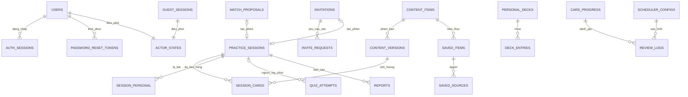
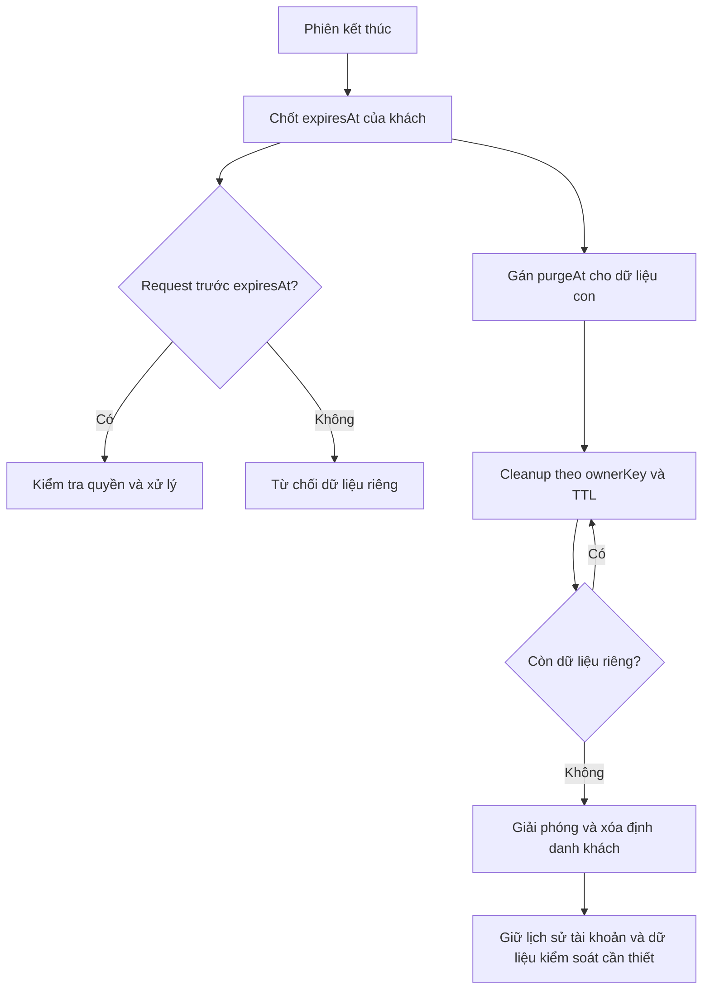

# Chiikaiwa — Thiết kế cơ sở dữ liệu

| Thuộc tính | Giá trị |
|---|---|
| Phiên bản | 1.2 |
| Ngày | 06/11/2026 |
| Phạm vi | MVP cho nhóm 5 thành viên, triển khai trong 3–4 tuần |
| Nền tảng | MongoDB Atlas Free; Mongoose; backend Node.js/Express viết bằng JavaScript |
| Cơ sở yêu cầu | Tổng quan dự án, SRS, Product Backlog và Kiến trúc hệ thống |

## 1. Mục đích và nguyên tắc

Tài liệu quy định collection, schema, reference, index, transaction và vòng đời dữ liệu để triển khai Mongoose model, repository và service. HTTP contract thuộc API Specification.

MongoDB là nguồn trạng thái nghiệp vụ có thẩm quyền. LiveKit đảm nhiệm media, chat và thông báo; client không quyết định quyền vào phòng, kết quả bốc thẻ, lịch FSRS hoặc điểm quiz. Không lưu âm thanh, video, lịch sử chat, mật khẩu, JWT hoặc token đặt lại mật khẩu ở dạng plaintext trong database.

MVP dùng một database, không tách database theo module. Dữ liệu nhỏ, có giới hạn tự nhiên và thường đọc cùng nhau được nhúng; quan hệ tăng theo thời gian được tách thành document riêng. Không nhúng lịch sử phiên, review log hoặc lượt quiz vào document người dùng.

Quy tắc vòng đời học liệu:

- Flashcard kiến thức chuẩn dùng bản đã xuất bản mới nhất. Nguồn đã lưu và lịch sử vẫn mở được bản từng gặp; thay nội dung không tự đặt lại tiến độ FSRS.
- Xóa thẻ thủ công loại thẻ khỏi mọi bộ cá nhân, xóa tiến độ và nhật ký ôn của thẻ; giữ số lượt ôn đã ghi trong thống kê tổng hợp. Bỏ lưu kiến thức chuẩn hoặc xóa bộ cá nhân không xóa tiến độ của kiến thức.

## 2. Quy ước dữ liệu

### 2.1. Kiểu, định danh và thời gian

| Quy ước | Thiết kế |
|---|---|
| ID | `_id: ObjectId`, trừ khóa String được nêu riêng. API biểu diễn ObjectId thành chuỗi. |
| Chủ thể | `actorKey: String`, dạng `user:<ObjectId>` hoặc `guest:<ObjectId>`. Server tạo và phân giải. |
| Chủ sở hữu | `ownerKey` cùng định dạng `actorKey`; có trong mọi truy vấn dữ liệu riêng. Không nhận chủ sở hữu từ request body. |
| Khóa thẻ học | `cardKey: String` = `knowledge:<contentId>` hoặc `manual:<manualCardId>`. Không chứa ID bộ, phiên hoặc revision. |
| Thời gian | BSON Date, UTC, lấy từ server. Thời lượng cộng dồn là số mili giây nguyên không âm. |
| Giá trị thiếu | Bỏ trường tùy chọn khi chưa có dữ liệu; không dùng giá trị suy đoán hoặc chuỗi rỗng thay thông tin thiếu. |
| Version | `version: Number` nguyên không âm, tăng qua mỗi cập nhật cạnh tranh. Không mặc định `__v` bảo vệ mọi loại update Mongoose. |
| Timestamp | Document thay đổi có `createdAt`, `updatedAt`; bản bất biến/log có `createdAt` cùng thời điểm nghiệp vụ. |
| Hết quyền và xóa | `expiresAt` là hạn nghiệp vụ; `purgeAt` là thời điểm đủ điều kiện xóa vật lý. Document còn tồn tại không đồng nghĩa còn quyền. |
| Dữ liệu khách | Collection học riêng có `purgeAt?`; dữ liệu tài khoản không gán trường này. Quyền luôn kiểm tra qua `guest_sessions`. |

Trong từ điển, `?` chỉ trường tùy chọn. Trường không có `?` bắt buộc ở trạng thái tương ứng. Reference là ObjectId trừ trường được ghi String; service kiểm tra đối tượng đích và quyền. MongoDB không tự thực thi foreign key hoặc cascade delete. Mảng ID không chứa phần tử trùng.

Version và bộ đếm bắt đầu từ 0; mảng hồ sơ chưa chọn là mảng rỗng. Object mới có trạng thái khởi đầu phù hợp loại: user active, actor idle, nguồn mời open, proposal pending, phiên preparing, quiz inProgress. Trạng thái khách active chỉ biểu thị đã được cấp lượt thử; phiên luyện vẫn chỉ bắt đầu khi đủ hai kết nối. Reference tùy chọn không đưa vào unique index đơn trường; các unique key tại mục 10 đều dùng trường bắt buộc.

Schema dùng kiểu cụ thể, enum, validator và danh sách trường cho phép. Không truyền object từ client trực tiếp vào filter/update MongoDB. Update cần validation phù hợp; quy tắc liên document kiểm tra tại service/transaction. `unique` khai báo index, không thay validator; duplicate key phải được xử lý thành lỗi nghiệp vụ. [DB-REF-02]

Các thuật ngữ dùng trong schema và transaction:

| Thuật ngữ | Ý nghĩa |
|---|---|
| CAS (compare-and-set) | Update chỉ thành công khi version/trạng thái khớp giá trị kỳ vọng. |
| Guard | Document được cập nhật trong transaction để tạo write conflict giữa các thao tác cạnh tranh. |
| Revision | Bản nội dung học liệu bất biến; khác version dùng kiểm soát cập nhật. |
| Projection | Tập trường được phép trả về cho danh tính và ngữ cảnh hiện tại. |
| Reconcile | Đối chiếu trạng thái, deadline và dịch vụ ngoài để hoàn tất chuyển trạng thái còn thiếu. |
| Receipt | Bản ghi nhận thao tác đã commit, dùng để xử lý retry theo idempotency key. |
| Cleanup | Xóa dữ liệu và giải phóng reference/giữ chỗ; phải chạy lại an toàn. |

### 2.2. Danh mục chung

| Trường | Giá trị lưu |
|---|---|
| `level` | `N5`, `N4`, `N3`, `N2`, `N1` |
| `desiredMinutes` | `10`, `20`, `30` |
| `ageGroup` | `under18`, `18to22`, `23to30`, `over30` |
| `gender` | `male`, `female`, `other`; bỏ trường nếu không cung cấp |
| `goal` | `dailyCommunication`, `travel`, `studyAndWork`, `examPreparation`, `culturalExchange` |
| `interests` | Tối đa 3 mã khác nhau: `music`, `filmAndAnime`, `food`, `travel`, `books`, `games`, `sports`, `technology` |
| `nativeLanguageCode`, `countryCode` | Mã từ danh mục dùng chung frontend/backend; quốc gia là nơi đang sinh sống. |
| Rating | `1 = Again`, `2 = Hard`, `3 = Good` |

Giao diện dùng nhãn tiếng Việt trong SRS, không hiển thị mã lưu trữ. Danh mục ngôn ngữ/quốc gia là cấu hình có kiểm soát phiên bản, không cần chức năng quản trị riêng. Không thu ngày sinh. Bộ lọc không giới hạn được biểu diễn bằng trường bị bỏ, khác với hồ sơ chưa khai báo khi đánh giá điều kiện ghép.

## 3. Mô hình tổng thể



Sơ đồ thể hiện quan hệ chính, không phải foreign key vật lý. Dữ liệu riêng liên kết tài khoản hoặc khách qua `ownerKey`. Một phiên có đúng hai thành viên; một đề nghị ghép hoặc mã mời tạo tối đa một phiên. Các reference đa loại phải kiểm tra đúng loại tại service.

| Nhóm | Collection |
|---|---|
| Danh tính | `users`, `auth_sessions`, `password_reset_tokens`, `guest_sessions` |
| Điều phối | `actor_states`, `match_proposals`, `invitations`, `invite_requests` |
| Hội thoại | `practice_sessions`, `session_cards`, `session_personal` |
| Học liệu | `content_items`, `content_versions` |
| Học cá nhân | `saved_items`, `saved_sources`, `personal_decks`, `deck_entries`, `manual_cards`, `card_progress`, `review_logs`, `scheduler_configs`, `quiz_attempts` |
| Kiểm soát và vận hành | `blocks`, `reports`, `operation_receipts`, `webhook_receipts`, `rate_limits`, `statistics` |

Các collection không tương ứng với dịch vụ triển khai độc lập. `content_items` và `content_versions` dùng chung cho bốn loại học liệu để thống nhất vòng đời xuất bản; schema của từng loại vẫn tách rõ.

## 4. Danh tính và xác thực

### 4.1. `users`

| Trường | Kiểu và ràng buộc |
|---|---|
| `email`, `emailKey` | String; `emailKey` là email trim/chuyển chữ thường dùng đăng nhập và unique. Không bỏ dấu chấm hoặc phần `+tag`. |
| `passwordHash` | String, hash bằng thuật toán chuyên dụng; không có mật khẩu mặc định. |
| `role` | `learner` hoặc `admin`; đăng ký công khai chỉ tạo `learner`. |
| `status` | `active` hoặc `locked`. |
| `displayName`, `avatarKey` | String; avatar thuộc bộ mặc định, không lưu file tải lên. |
| `profile` | Object: `level?`, `nativeLanguageCode?`, `goal?`, `interests`, `countryCode?`, `ageGroup?`, `gender?`. Bắt buộc level trước khi tìm tự động. |
| `authVersion` | Number nguyên; tăng khi đổi/reset mật khẩu hoặc thu hồi mọi phiên đăng nhập. |
| `version` | Version cập nhật tài khoản/hồ sơ. |
| `statusChangedAt?`, `statusChangedBy?` | Date và ObjectId Admin thay trạng thái. |

Không trả email/password hash trong hồ sơ đối tác. Admin được cấp qua quy trình khởi tạo có kiểm soát, không qua trường `role` do form đăng ký gửi.

### 4.2. `auth_sessions` và `password_reset_tokens`

| Collection | Trường |
|---|---|
| `auth_sessions` | `userId`, `authVersion: Number`, `issuedAt: Date`, `expiresAt: Date`, `revokedAt?: Date`, `purgeAt: Date`. `_id` là session ID trong JWT. |
| `password_reset_tokens` | `userId`, `tokenHash: String`, `expiresAt: Date`, `usedAt?: Date`, `invalidatedAt?: Date`, `purgeAt: Date`. |

Phiên đăng nhập tối đa 7 ngày tuyệt đối. API kiểm tra JWT, bản ghi phiên, trạng thái user và `authVersion`. Logout thu hồi phiên hiện tại. Đổi/reset mật khẩu tăng `authVersion`, khiến mọi phiên cũ mất hiệu lực ngay cả khi chưa xóa bản ghi.

Token reset ngẫu nhiên đủ mạnh, chỉ lưu hash, hạn 15 phút và dùng một lần. Transaction reset thay hash mật khẩu, tiêu thụ token, vô hiệu token reset còn lại và tăng `authVersion`. Phát hành token reset cũng cập nhật version user để cạnh tranh với reset đang chạy. Gửi email qua Brevo sau khi lưu, ngoài transaction; không đổi mật khẩu chỉ vì đã gửi yêu cầu. Phản hồi công khai không tiết lộ email tồn tại.

Hai collection gán `purgeAt = expiresAt`. Dọn trễ không kéo dài quyền. Không cần lưu JWT hoặc URL reset đầy đủ.

### 4.3. `guest_sessions`

| Trường | Kiểu và ràng buộc |
|---|---|
| `credentialHash` | String; hash bí mật ngẫu nhiên trong cookie khách. |
| `invitationId` | Mã mời gắn với luồng xin vào hiện tại. |
| `practiceSessionId?` | Gắn khi được chấp nhận vào phiên. |
| `status` | `waiting`, `active`, `summary`, `expired`. |
| `expiresAt?` | Date; sau phiên cố định bằng `endedAt + 15 phút`. |
| `version` | Guard cho ghi dữ liệu riêng và chuyển vòng đời khách. |
| `cleanupState` | `pending` hoặc `complete`. |

Khách đang chờ chỉ có quyền trong luồng mã mời, không học độc lập. Nếu mã hết hạn/bị hủy hoặc yêu cầu bị từ chối mà chưa cấp phiên, giải phóng điều phối và dọn định danh chờ không còn dùng; không cấp thêm thời gian ôn cho một phiên chưa tồn tại. Khách đã được chấp nhận chỉ dùng dữ liệu học của đúng lượt thử, không chuyển sang tài khoản mới.

Không đặt TTL lên bản ghi gốc trước khi xử lý dữ liệu con. Bản ghi gốc là căn cứ deadline và cleanup; xóa sau khi cleanup hoàn tất. Không tìm thấy bản ghi gốc thì từ chối cookie khách cũ.

## 5. Tìm bạn và phòng mời

### 5.1. `actor_states`

Mỗi danh tính có đúng một document, `_id = actorKey`. Đây là điểm tranh chấp ghi chung giữa tìm bạn, mã mời, cấp phòng, chặn và khóa tài khoản.

| Trường | Kiểu và ràng buộc |
|---|---|
| `mode` | `idle`, `searching`, `proposed`, `inviting`, `requestingInvite`, `inSession`. |
| `resourceId?` | ID đề nghị, mã mời, yêu cầu vào hoặc phiên; không có khi `idle`. |
| `version` | Tăng khi thay giữ chỗ hoặc kiểm soát quyền cấp phòng. |
| `search?` | Chỉ khi `searching`: `requestId: String`, `level`, `desiredMinutes`, `allowAdjacent: Boolean`, `profileSnapshot`, `filters`, `queuedAt: Date`, `leaseUntil: Date`. |

Snapshot chứa hồ sơ tùy chọn dùng ghép; filters chứa quốc gia, nhóm tuổi, giới tính mong muốn nếu có. Thay tiêu chí hủy yêu cầu cũ, tạo request ID và thời điểm chờ mới. Không tự đổi snapshot giữa lượt tìm.

Truy vấn ứng viên có `mode=searching` và lease còn hiệu lực. Áp dụng điều kiện và thứ tự xếp hạng BR-01–03 trên snapshot; kiểm tra lại block, trạng thái tài khoản và guard trước khi commit đề nghị.

Lease giải phóng tìm kiếm bị bỏ lại khi đóng tab, không phải giới hạn thời gian tìm tối đa. Chu kỳ heartbeat/lease được khóa ở cấu hình API phù hợp polling. Không TTL actor state khi còn giữ chỗ; xóa nó trước khi giải phóng tài nguyên có thể cho phép hai luồng đồng thời.

### 5.2. `match_proposals`

| Trường | Kiểu và ràng buộc |
|---|---|
| `participants` | Đúng 2 tài khoản khác nhau: `actorKey`, `searchRequestId`, `criteriaSnapshot`, `acceptedAt?`. |
| `status` | `pending`, `accepted`, `rejected`, `cancelled`, `expired`. |
| `expiresAt` | Date = thời điểm đề nghị + 30 giây. |
| `practiceSessionId?` | Chỉ có khi cả hai chấp nhận hợp lệ. |
| `version` | Version dùng cho CAS. |

Tạo đề nghị và chuyển hai actor state sang `proposed` trong transaction. Từ chối/hủy/hết hạn giải phóng cả hai, không tự tìm lại. Cả hai đồng ý chỉ tạo một phiên. `suggestedMinutes` lấy giá trị nhỏ hơn trong hai lựa chọn theo BR-10.

### 5.3. `invitations` và `invite_requests`

| Collection | Trường |
|---|---|
| `invitations` | `hostKey: String`, `code: String`, `status: open/used/cancelled/expired`, `expiresAt: Date`, `practiceSessionId?`, `version`. Hạn mã 10 phút. |
| `invite_requests` | `invitationId`, `requesterKey: String`, `status: pending/accepted/rejected/cancelled/expired`, `expiresAt: Date`, `version`. Hạn không vượt hạn mã. |

Mã được sinh ngẫu nhiên phía server, chỉ người tạo được xem lại trong lúc mã còn hiệu lực. Mã là định danh xin vào, không phải quyền media: người nhập vẫn cần được chủ phòng chấp nhận. Không ghi mã trong log truy cập; endpoint tra mã có rate limit. Hết hạn hoặc dùng xong không cho mã cấp quyền mới.

Nhiều người có thể xin cùng mã, nhưng chỉ chấp nhận một người. Tách yêu cầu khỏi invitation để không có mảng tăng không giới hạn. Người xin vào cũng giữ chỗ tại actor state, không đồng thời tìm tự động/xin phòng khác. Transaction chấp nhận kiểm tra lại hạn, người tạo, block, khóa và giữ chỗ; tạo phiên, chuyển mã `used`, chuyển hai người sang `inSession`.

Yêu cầu còn lại được đánh dấu không còn hiệu lực và giải phóng giữ chỗ. Với cleanup theo lô, mọi request trước khi dùng actor state phải reconcile nguồn đã `used`; không để giữ chỗ cũ chặn người dùng lâu dài. Mã đã dùng không thay được thành viên phiên. Phòng mời không áp tiêu chí tìm tự động nhưng vẫn kiểm tra block, khóa và giới hạn hai người.

## 6. Phiên Kaiwa

### 6.1. `practice_sessions`

| Trường | Kiểu và ràng buộc |
|---|---|
| `originKind`, `originId` | `match` hoặc `invite`; ID nguồn. Cặp này duy nhất. |
| `members` | Đúng 2 phần tử khác nhau: `actorKey`, `kind: user/guest`, `userId?`. `userId` chỉ dành cho tài khoản; lịch sử hiển thị khách là “Khách”. |
| `status`, `version` | `preparing`, `active`, `reconnecting`, `ended`; version CAS cho thao tác chung. |
| `controllerKey?` | String thuộc members; random một lần trong transaction bắt đầu phiên, bắt buộc sau startedAt. Lấy quyền cập nhật trường này và tăng version phiên; yêu cầu cả hai kết nối và phiên active. Ghi receipt cùng transaction; replay không chuyển quyền lần nữa. Reconnect giữ nguyên. |
| `roomName` | String duy nhất, không dùng lại giữa các phiên. |
| `suggestedMinutes?` | Number từ ghép tự động; không bắt buộc với phòng mời. |
| `startedAt?`, `endedAt?`, `endReason?` | Date, Date, String mã lý do kết thúc. Chỉ có startedAt khi cả hai kết nối media. |
| `presence` | Đúng 2 phần tử: `actorKey`, `connected: Boolean`, `connectionSid?`, `lastEventAt?: Date`, `disconnectedAt?: Date`, `reconnectUntil?: Date`. |
| `activeDurationMs`, `activeSince?` | Thời lượng đã chốt và Date bắt đầu khoảng cả hai đang kết nối. |
| `deckVersionId?` | Bản bộ đã chọn, chỉ chọn một lần. |
| `selectionRemainingMs`, `selectionRunningSince?` | Ban đầu 60.000 ms khi bắt đầu chọn bộ; Date khi bộ đếm đang chạy. |
| `currentCardId?` | ID lá đang luyện. |
| `pendingAction?` | `{id: String, kind, cardId, proposedBy: String, proposedAt: Date, baseVersion: Number}`; kind là `swapRoles`, `skip`, `completeAndNext`. |
| `screenShare` | `{state: idle/granting/active/revoking, ownerKey?, operationId?: String, version}`. |
| `mediaCleanup` | `{state: none/pending/complete, attempts: Number, lastAttemptAt?: Date, lastErrorCode?: String}`. Không chứa token. |

Lý do kết thúc phân biệt rời chủ động, quá hạn kết nối lại, hết thời gian chọn bộ, chặn/khóa thu hồi quyền và lỗi hệ thống; không gộp thành “hoàn thành”. Mapping thông báo thuộc API.

Khi mất kết nối, chốt khoảng activeSince, giảm thời gian chọn đã trôi, đặt reconnectUntil bằng lúc server phát hiện cộng 5 phút, hủy pendingAction. Khi cả hai trở lại, mở khoảng hoạt động mới, không cấp lại 60 giây. Nhiều deadline cùng tồn tại thì dùng deadline đến trước. Reconcile muộn dùng deadline nghiệp vụ làm mốc kết thúc, không lấy giờ cron chạy.

Không cộng thời gian chỉ có một người hoặc hiện diện chưa xác nhận. Webhook muộn phải đối chiếu SID kết nối, thời điểm sự kiện và trạng thái; khi mâu thuẫn, đối chiếu LiveKit. Sự kiện cũ không hồi sinh phiên ended. Cấp quyền chia sẻ màn hình phải qua CAS screenShare, thu hồi người cũ trước khi cấp người mới và kiểm tra lại version sau lời gọi LiveKit.

Trong giai đoạn preparing, mất liên lạc khi vào phòng cũng áp giới hạn phục hồi 5 phút theo SRS mục 4.1. Dùng presence/reconnectUntil để giải phóng khi quá hạn; không để người chưa vào được phòng chiếm chỗ vô thời hạn. Không ghi startedAt hoặc tăng số phiên đã luyện nếu chưa đủ hai kết nối. Khi hoàn tất chọn bộ, ngừng bộ đếm chọn; deadline cũ không được kết thúc phiên sau đó.

### 6.2. `session_cards`

| Trường | Kiểu và ràng buộc |
|---|---|
| `sessionId`, `scenarioVersionId` | Mỗi tình huống xuất hiện tối đa một lần trong phiên. |
| `slot` | Number nguyên không âm, vị trí lá úp duy nhất trong phiên. |
| `status` | `faceDown`, `current`, `completed`, `skipped`, `unfinished`. |
| `drawnAt?`, `finishedAt?` | Date. |
| `roleAKey?`, `roleBKey?` | String của hai thành viên khác nhau; random khi bốc, đổi chỗ khi đồng thuận. |

Chọn bộ xong, backend xáo và lưu ánh xạ slot–tình huống. Client chỉ nhận slot/trạng thái lá úp, không nhận tình huống chưa bốc. Chỉ controllerKey hiện tại được bốc; filter ghi kiểm tra controllerKey và version phiên. Bốc cạnh tranh lấy quyền chỉ commit theo trạng thái hợp lệ, request cũ bị từ chối.

`currentCardId` và CAS phiên quyết định lá hiện hành. Transaction kết thúc lá cũ và đặt lá mới; unique phiên–slot và phiên–tình huống ngăn lặp. Kết thúc phiên đánh dấu lá current thành unfinished; các lá chưa bốc vẫn faceDown. Skip/complete không đưa lá trở lại chồng bài. Hết bộ không tự chọn bộ mới.

Vai được dựng từ scenario revision và phân vai hiện tại. API chỉ trả vai người gọi được phép xem, không trả cả hai rồi ẩn bằng giao diện. Pending action phải đúng ID, lá và người đối tác xác nhận; đề nghị khác không được coi là đồng ý. Đổi vai không thu hồi thông tin đã được nhìn thấy.

### 6.3. `session_personal`

Document duy nhất theo `ownerKey + sessionId`: `note?: String`, `noteVersion: Number`, `selfAssessment?: {confidence: Number 1..5, comment?: String}`, `version`, `purgeAt?` và timestamps. Note là văn bản thuần cho cả phiên, không tách theo từng lá.

Autosave gửi version kỳ vọng để không ghi đè note mới từ tab khác. Xóa note chỉ xóa trường note, giữ tự đánh giá. Cả hai trường chỉ chủ sở hữu được đọc/sửa; Admin không có quyền đọc mặc định. Tổng kết được dựng từ phiên, lá và dữ liệu riêng người đang xem, không lưu bản tổng kết gộp dữ liệu cá nhân của cả hai.

## 7. Học liệu và phiên bản

### 7.1. `content_items`

Collection chứa định danh ổn định của bộ chủ đề, tình huống, kiến thức và câu hỏi. Dùng schema phân biệt theo kind; không dùng `Mixed` tự do cho toàn bộ payload.

| Trường | Kiểu và ràng buộc |
|---|---|
| `kind` | `deck`, `scenario`, `knowledge`, `question`; không đổi sau tạo. |
| `status` | `draft`, `published`, `hidden`. |
| `level?`, `title?` | Trường danh mục của bộ; level thuộc N5–N1. |
| `draftPayload?` | Object theo loại tại mục 7.2; chỉ Admin sửa/xem. |
| `publishedVersionId?` | Bản xuất bản gần nhất, giữ reference khi ẩn. |
| `latestRevision` | Number nguyên không âm. |
| `version`, `createdBy`, `updatedBy` | Version và ID Admin. |

Sửa nháp không thay bản đang dùng. Xuất bản tạo revision mới và đổi con trỏ trong transaction. Ẩn ngăn chọn mới; không xóa revision được dùng trong phiên, bookmark hoặc quiz.

### 7.2. `content_versions`

Trường chung: `contentId`, `kind`, `revision: Number` nguyên dương, `payload`, `publishedAt: Date`, `publishedBy`. Unique contentId–revision. Bản xuất bản bất biến: không update payload hoặc xóa phá tham chiếu.

| Loại | Cấu trúc payload |
|---|---|
| `knowledge` | `type: vocabulary/grammar`, `expression: String`, `reading?: String`, `meaning: String`, `examples: Array<{japanese: String, vietnamese: String}>`. |
| `question` | `type: multipleChoice/shortAnswer`, `prompt: String`, `options?: Array<{id: String, text: String}>`, `correctOptionId?: String`, `acceptedAnswers?: String[]`, `explanation: String`, `knowledgeVersionIds: ObjectId[]`. |
| `scenario` | `title: String`, `context: String`, `objective: String`, `roleA: String`, `roleB: String`, `hints: String[]`, `knowledgeVersionIds: ObjectId[]`, `questionVersionIds: ObjectId[]`. |
| `deck` | `title: String`, `topicKey: String`, `level`, `description: String`, `scenarioVersionIds: ObjectId[]`, `knowledgeVersionIds: ObjectId[]`, `questionVersionIds: ObjectId[]`. |

Reference phải đúng kind. Câu trắc nghiệm có đúng một đáp án trong options; câu điền có ít nhất một đáp án chấp nhận. Bộ xuất bản có ít nhất một tình huống hoàn chỉnh; mỗi tình huống có ít nhất ba câu quiz, đủ mục tiêu, hai vai và gợi ý. Kiến thức phải có nghĩa/ví dụ.

Bản bộ chứa danh sách học liệu hiệu lực tại lúc xuất bản. Service hợp nhất kiến thức/câu hỏi từ các tình huống, kiểm tra liên kết và loại trùng theo định danh nguồn; không cho hai revision của cùng một mục cùng nằm trong manifest bộ. Thay đổi mục con đi vào manifest mới khi xuất bản lại bộ; phiên đang chạy và lịch sử dùng manifest cũ không đổi. Không cần giao diện quản lý nhiều phiên bản trong MVP.

Danh mục chọn mới lấy bộ đang published và publishedVersionId. Lịch sử lấy deckVersionId đã cố định. Học flashcard lấy các contentId của tập nguồn rồi phân giải bản xuất bản mới nhất; xem nguồn cũ vẫn trả revision từng gặp. Nội dung ẩn không xuất hiện trong lựa chọn mới, nhưng người có nguồn/lịch sử hợp lệ vẫn được xem và ôn; biết ObjectId không tự cấp quyền.

Quiz dùng ngân hàng của bản bộ đang được mở và được phép truy cập, không phụ thuộc danh sách bookmark. Lượt quiz chụp câu hỏi/đáp án riêng khi tạo để không đổi theo lần xuất bản sau.

Mảng manifest không chứa log người dùng. Validator kiểm tra kích thước BSON trước xuất bản, từ chối document vượt giới hạn MongoDB thay vì cắt danh sách. Khi quy mô học liệu đòi hỏi chia manifest, cần migration trước khi mở rộng. [DB-REF-05]

## 8. Dữ liệu học cá nhân

### 8.1. Mục đã lưu và nguồn

| Collection | Trường |
|---|---|
| `saved_items` | `ownerKey`, `knowledgeId`, `isSaved: Boolean`, `savedAt: Date`, `version`, `purgeAt?`. Unique chủ sở hữu–kiến thức. |
| `saved_sources` | `savedItemId`, `ownerKey`, `knowledgeId`, `knowledgeVersionId`, `contextKey: String`, `deckVersionId`, `sessionId?`, `scenarioVersionId?`, `purgeAt?`, `createdAt`. |

Server tạo contextKey theo nguồn: `session:<sessionId>:<scenarioVersionId>:<knowledgeVersionId>` hoặc `deck:<deckVersionId>:<knowledgeVersionId>`. Nguồn phiên phải thuộc phiên người đó tham gia và tình huống đã bốc; nguồn ngoài cuộc gọi không có sessionId giả.

Lưu lặp chỉ bật isSaved và bổ sung nguồn chưa có; unique source ngăn lặp do retry. Bỏ lưu đặt isSaved=false, giữ nguồn đã ghi để lịch sử vẫn truy được. Lưu lại không tạo định danh mới hoặc reset FSRS. Phần đã lưu chỉ liệt kê isSaved=true. Mỗi source giữ chính xác revision đã gặp, không đổi con trỏ theo bản xuất bản mới.

### 8.2. Bộ cá nhân và thẻ thủ công

| Collection | Trường |
|---|---|
| `personal_decks` | `ownerKey`, `name: String`, `status: active/deleting`, `version`, `purgeAt?`, timestamps. |
| `deck_entries` | `ownerKey`, `deckId`, `cardKey`, `purgeAt?`, `createdAt`. Unique bộ–thẻ. |
| `manual_cards` | `ownerKey`, `front: String`, `back: String`, `status: active/deleting`, `version`, `purgeAt?`, timestamps. |

Thẻ thủ công chỉ thuộc một người, không tự hợp nhất với kiến thức chuẩn bằng so sánh văn bản. Thêm entry kiểm tra bộ cùng chủ, nguồn được phép dùng và thẻ thủ công còn active. Một thẻ có thể ở nhiều bộ nhưng chỉ có một tiến độ.

Xóa bộ đánh dấu deleting bằng CAS, ngăn thêm entry mới, xóa các entry rồi xóa bộ. Giữ thẻ nguồn, thẻ thủ công và tiến độ. Thêm entry phải cập nhật version bộ trong cùng transaction, không chỉ đọc sự tồn tại trước khi insert. Bộ deleting không còn hiển thị cho người học.

Xóa thẻ thủ công đánh dấu deleting/tăng version trước, làm thẻ mất quyền học ngay. Sau đó xóa entry, card_progress, review_logs, receipt liên quan rồi xóa thẻ. Cleanup theo lô khi cần và chạy lại an toàn. Review, sửa thẻ và thêm entry đều phải cập nhật guard của thẻ active, không tạo dữ liệu con khi đang xóa. Không giảm thống kê lượt ôn đã xảy ra; không giữ bản sao mặt hỏi/đáp trong log vận hành.

Quyền khách chỉ gồm thao tác dùng thử trong SRS. Cấu trúc ownerKey hỗ trợ khách không tự cấp thêm quyền quản lý bộ hoặc tạo thẻ thủ công.

### 8.3. `card_progress`

| Trường | Kiểu và ràng buộc |
|---|---|
| `ownerKey`, `cardKey` | Khóa duy nhất của tiến độ. |
| `state` | `new`, `learning`, `review`, `relearning`; adapter ánh xạ sang enum thư viện. |
| `dueAt` | Date do scheduler tính. |
| `stability`, `difficulty` | Number hữu hạn theo trạng thái do FSRS trả, không cho client đặt. |
| `elapsedDays`, `scheduledDays` | Number không âm theo contract scheduler. |
| `reps`, `lapses`, `learningSteps` | Number nguyên không âm theo contract scheduler. |
| `lastReviewAt?` | Date đánh giá trước. |
| `schedulerConfigId` | String tham chiếu cấu hình bất biến. |
| `version`, `purgeAt?` | Version dùng cho CAS và hạn xóa dữ liệu khách. |

Chưa có document tiến độ nghĩa là thẻ mới. Khi đánh giá lần đầu, server tạo trạng thái theo scheduler; preview không tạo review log. Danh sách đến hạn kết hợp thẻ mới trong tập học và tiến độ có dueAt không lớn hơn giờ server; không chỉ query collection tiến độ rồi bỏ sót thẻ chưa học.

Tập học lấy từ bộ chủ đề, danh sách đã lưu hoặc bộ cá nhân. Tiến độ không lưu một deckId cố định; revision nội dung cũng không tham gia khóa unique. Học sớm dùng thời điểm đánh giá thực tế; quá hạn không tự reset hoặc sinh đánh giá.

### 8.4. `review_logs` và `scheduler_configs`

| Collection | Trường |
|---|---|
| `review_logs` | `ownerKey`, `cardKey`, `operationId: String`, `payloadHash: String`, `rating: Number 1/2/3`, `reviewedAt: Date`, `contentVersionId?`, `manualVersion?: Number`, `beforeState`, `afterState`, `schedulerConfigId: String`, `purgeAt?`. |
| `scheduler_configs` | `_id: String` là hash cấu hình chuẩn hóa; `model: FSRS-6`, `libraryName: ts-fsrs`, `libraryVersion: 6.0.0`, `weights: Number[21]`, `retention: 0.90`, `learningStepsMinutes: [1,10]`, `relearningStepsMinutes: [10]`, `enableFuzz: false`, `enableShortTerm: true`, `maximumIntervalDays: 36500`, `fractionalDays: false`, `roundingPolicy: String`, `stepPolicy: String`, `createdAt`. |

Theo quyết định BE-006, `roundingPolicy = ts-fsrs@6.0.0/native` và `stepPolicy = ts-fsrs@6.0.0/native;graduatingInterval=1;allowModelOverride=false`; ý nghĩa tại SRS mục 6.2. `_id` dùng SHA-256 của JSON UTF-8 không khoảng trắng, bỏ `_id`/`createdAt`, giữ thứ tự trường: model, libraryName, libraryVersion, weights, retention, learningStepsMinutes, relearningStepsMinutes, enableFuzz, enableShortTerm, maximumIntervalDays, fractionalDays, roundingPolicy, stepPolicy. Thứ tự phần tử các mảng được giữ nguyên. Lưu cấu hình lần đầu kèm `createdAt`, không cập nhật đè bản có cùng ID; reader kiểm tra đủ giá trị cấu hình, không chỉ tin ID do caller truyền vào.

beforeState/afterState chứa toàn bộ trạng thái scheduler tại mục 8.3 gồm version tương ứng, không chứa note hoặc mặt thẻ. contentVersionId ghi bản thực sự hiển thị khi đánh giá. Nếu Admin xuất bản trong lúc đang học, không gán nhầm revision mới cho lượt đã mở. Thẻ thủ công lưu version nội dung, không lưu bản sao nội dung vào log.

Luồng mở đáp án trả một vé đánh giá được server ký, gắn owner, cardKey, revision nội dung và version tiến độ. Review kiểm tra vé cùng rating; chưa mở đáp án thì không có vé hợp lệ. Vé không tạo lượt ôn, không chứng minh người dùng đã đọc/ghi nhớ và không thay kiểm tra quyền hiện tại. Chi tiết chữ ký/hiệu lực vé thuộc API.

Transaction review cập nhật tiến độ, ghi đúng một log và tăng thống kê. Unique ownerKey–operationId bảo vệ retry dài hạn; CAS version tiến độ chống hai ý định khác ID dựa vào cùng trạng thái cũ. Lần đầu chưa có tiến độ được bảo vệ bởi unique ownerKey–cardKey; request thua cuộc tải lại thay vì tự đánh giá thêm lần nữa.

Tham số FSRS-6 dùng chung preview/review, không có optimizer cá nhân hoặc nút Easy. Cấu hình bất biến lưu trọng số:

```text
[0.212, 1.2931, 2.3065, 8.2956, 6.4133, 0.8334, 3.0194,
 0.001, 1.8722, 0.1666, 0.796, 1.4835, 0.0614, 0.2629,
 1.6483, 0.6014, 1.8729, 0.5425, 0.0912, 0.0658, 0.1542]
```

Phiên bản thư viện, giới hạn khoảng tối đa, làm tròn và chuyển bước phải được ghim trước khi sinh fixture, theo SRS mục 6. Chỉ cho phép ghi review khi cấu hình đã đủ tham số và được ghim; thay dependency không tự thay cấu hình đang dùng.

### 8.5. `quiz_attempts`

| Trường | Kiểu và ràng buộc |
|---|---|
| `ownerKey`, `deckVersionId` | Chủ sở hữu và bản bộ dùng tạo lượt. |
| `sourceSessionId?` | Chỉ có khi mở từ tổng kết/lịch sử phiên hợp lệ. |
| `status` | `inProgress` hoặc `submitted`. |
| `questions` | Array 1–5 câu khác nhau: questionVersionId, type, prompt, options?, correctOptionId?, acceptedAnswers?, explanation, knowledgeVersionIds. Kiểu từng trường như mục 7.2. |
| `answers?` | Array `{questionVersionId, optionId?: String, text?: String}`; đáp án đã nộp, có thể bỏ trống câu. |
| `results?` | Array `{questionVersionId, isCorrect: Boolean, points: Number 0/1}`. |
| `score?`, `total` | Number nguyên; 0 ≤ score ≤ total; total bằng số câu snapshot. |
| `submittedAt?`, `submitOperationId?`, `submitPayloadHash?` | Date và hai String của lần nộp hợp lệ. |
| `version`, `purgeAt?` | Version và vòng đời khách. |

Snapshot có đáp án chuẩn chỉ nằm phía server; projection trước nộp chỉ lấy câu hỏi và lựa chọn công khai. Ngân hàng rỗng không tạo lượt. Chọn tối đa 5 định danh câu hỏi khác nhau, ít hơn thì lấy tất cả. Làm lại tạo ID mới; lần đã nộp giữ snapshot/kết quả bất biến.

Chấm điền ngắn chỉ trim đầu/cuối rồi so chính xác một đáp án chấp nhận; không đổi hoa/thường, kana/kanji hoặc dấu câu. Chuyển inProgress sang submitted và tăng thống kê trong transaction. Retry trả kết quả cũ, không chấm lại theo ngân hàng mới. Payload khác sau nộp không thay kết quả. Quiz không ghi card_progress hoặc tự tạo saved_items.

## 9. Kiểm soát và vận hành

| Collection | Cấu trúc và mục đích |
|---|---|
| `blocks` | `blockerKey: String`, `blockedKey: String`, `createdAt`; cặp có hướng duy nhất, không tự chặn mình. Tra cả hai hướng khi ghép/mời. |
| `reports` | `reporterKey: String`, `reportedKey: String`, `sessionId`, `reason: String`, `description?: String`, `status: new/inProgress/resolved/rejected`, `resolution?: String`, `handledBy?`, `handledAt?: Date`, `version`, timestamps. |
| `operation_receipts` | `actorKey`, `action: String`, `resourceKey: String`, `operationId: String`, `payloadHash: String`, `resultRef?: String`, `committedAt: Date`, `purgeAt: Date`. Không cache vai hoặc nội dung cá nhân. |
| `webhook_receipts` | `eventId: String`, `eventType: String`, `roomName: String`, `connectionSid?: String`, `occurredAt: Date`, `processedAt: Date`, `purgeAt: Date`. Không lưu toàn bộ webhook/token. |
| `rate_limits` | `_id: String` là khóa phạm vi–chủ thể–cửa sổ, `count: Number` nguyên không âm, `windowEndsAt: Date`, `purgeAt: Date`. |
| `statistics` | `_id: String` cố định `lifetime`, `registeredAccounts`, `startedSessions`, `reviewCount`, `submittedQuizCount`: Number nguyên không âm; `updatedAt`. |

Báo cáo phải gắn đúng hai thành viên của phiên. Admin xử lý báo cáo không được mở rộng quyền sang note, thẻ thủ công hoặc cuộc gọi. Gỡ block chỉ xóa bản chặn do mình tạo; phía còn lại vẫn chặn thì cặp vẫn không được ghép.

Thống kê tăng cùng transaction của sự kiện gốc: tạo tài khoản người học, phiên lần đầu cả hai kết nối, review thành công, quiz lần đầu nộp. Admin khởi tạo được ghi nhận riêng trong số tài khoản theo cùng định nghĩa đếm tổng tài khoản, chạy seed lại không tăng lần nữa. Không tăng do phòng chờ, request lặp, preview hoặc bấm lưu.

Một document tổng hợp đủ cho tải demo. Log khách hoặc thẻ thủ công bị xóa có thể không còn, nên không tính lại tổng lượt bằng số log hiện tồn tại. Restore phải khôi phục bộ đếm từ cùng snapshot dữ liệu.

Thời gian giữ receipt/webhook và ngưỡng rate limit là cấu hình vận hành khóa tại API/triển khai, không phải lịch giữ dữ liệu học. Receipt chỉ là lớp chống lặp ngắn hạn; version, trạng thái cuối và unique nghiệp vụ vẫn bảo vệ khi receipt đã bị dọn. Replay kiểm tra quyền hiện tại, không trả vai cũ hoặc dữ liệu đã xóa.

## 10. Index và truy vấn

### 10.1. Danh mục index

Mọi collection có index `_id`. Các index bổ sung dùng thứ tự trường dưới đây; `U` là unique, `Q` là index truy vấn. Tạo bằng migration có kiểm soát, không phụ thuộc autoIndex lúc khởi động production.

| Collection | Key và loại | Mục đích |
|---|---|---|
| `users` | `{emailKey: 1}` U | Một tài khoản mỗi email chuẩn hóa. |
| `auth_sessions` | `{userId: 1, expiresAt: 1}` Q | Tra/thu hồi phiên. |
| `password_reset_tokens` | `{tokenHash: 1}` U; `{userId: 1, expiresAt: 1}` Q | Tra token và vô hiệu cùng tài khoản. |
| `guest_sessions` | `{credentialHash: 1}` U; `{status: 1, expiresAt: 1}` Q | Xác thực và cleanup. |
| `actor_states` | `{mode: 1, "search.level": 1, "search.queuedAt": 1}` Q | Lấy ứng viên theo cấp/thời điểm chờ. |
| `match_proposals` | `{status: 1, expiresAt: 1}` Q | Reconcile hết hạn. |
| `invitations` | `{code: 1}` U; `{status: 1, expiresAt: 1}` Q | Tra mã, hết hạn. |
| `invite_requests` | `{invitationId: 1, requesterKey: 1}` U; `{invitationId: 1, status: 1}` Q | Chống yêu cầu trùng, duyệt/giải phóng. |
| `practice_sessions` | `{originKind: 1, originId: 1}` U; `{roomName: 1}` U | Một phiên từ một nguồn; tra phòng media. |
| `practice_sessions` | `{"members.actorKey": 1, startedAt: -1, _id: -1}` Q | Lịch sử phân trang. |
| `practice_sessions` | `{status: 1, "presence.reconnectUntil": 1}` Q; `{"mediaCleanup.state": 1, updatedAt: 1}` Q | Reconnect và retry thu hồi. |
| `session_cards` | `{sessionId: 1, slot: 1}` U; `{sessionId: 1, scenarioVersionId: 1}` U | Slot/tình huống không lặp. |
| `session_personal` | `{ownerKey: 1, sessionId: 1}` U | Một dữ liệu riêng mỗi người–phiên. |
| `content_items` | `{kind: 1, status: 1, level: 1, _id: 1}` Q | Danh mục học liệu. |
| `content_versions` | `{contentId: 1, revision: 1}` U | Revision không trùng. |
| `saved_items` | `{ownerKey: 1, knowledgeId: 1}` U; `{ownerKey: 1, isSaved: 1, savedAt: -1, _id: -1}` Q | Chống trùng, liệt kê đã lưu. |
| `saved_sources` | `{ownerKey: 1, knowledgeId: 1, contextKey: 1}` U; `{ownerKey: 1, sessionId: 1}` Q | Nguồn không trùng, tổng kết riêng. |
| `personal_decks` | `{ownerKey: 1, status: 1, createdAt: -1, _id: -1}` Q | Danh sách bộ riêng. |
| `deck_entries` | `{deckId: 1, cardKey: 1}` U; `{ownerKey: 1, cardKey: 1}` Q | Chống trùng; xóa thẻ khỏi mọi bộ. |
| `manual_cards` | `{ownerKey: 1, status: 1, _id: 1}` Q | Thẻ riêng và cleanup. |
| `card_progress` | `{ownerKey: 1, cardKey: 1}` U; `{ownerKey: 1, dueAt: 1, _id: 1}` Q | Một tiến độ, thẻ đến hạn. |
| `review_logs` | `{ownerKey: 1, operationId: 1}` U; `{ownerKey: 1, cardKey: 1, reviewedAt: -1, _id: -1}` Q | Chống ghi lặp, lịch ôn/xóa theo thẻ. |
| `quiz_attempts` | `{ownerKey: 1, createdAt: -1, _id: -1}` Q; `{ownerKey: 1, sourceSessionId: 1}` Q | Lịch sử quiz/tổng kết. |
| `blocks` | `{blockerKey: 1, blockedKey: 1}` U | Danh sách chặn và tra hai hướng. |
| `reports` | `{status: 1, createdAt: -1, _id: -1}` Q; `{sessionId: 1}` Q | Hàng đợi xử lý. |
| `operation_receipts` | `{actorKey: 1, action: 1, resourceKey: 1, operationId: 1}` U | Cùng ý định trong cùng phạm vi chỉ commit một lần. |
| `webhook_receipts` | `{eventId: 1}` U | Webhook trùng không gây tác dụng lần hai. |

Yêu cầu xin vào đã kết thúc có thể chuyển lại pending cho cùng mã còn mở bằng CAS, tăng version và giữ chỗ lại; không insert bản thứ hai để vượt unique. Chấp thuận phải khớp ID và version yêu cầu đang hiển thị, tránh duyệt nhầm lượt mới.

Không tạo index ghép hai trường mảng khác nhau. Index lịch sử chỉ có mảng members; index reconnect chỉ có mảng presence. Với quy mô MVP, lọc hồ sơ sau khi lấy ứng viên đủ cấp/lease; không tạo mọi tổ hợp index cho tiêu chí tùy chọn.

### 10.2. TTL

Index riêng `{purgeAt: 1}`, `expireAfterSeconds: 0`, áp dụng cho auth_sessions, password_reset_tokens, operation_receipts, webhook_receipts, rate_limits và các collection học riêng có purgeAt tại mục 6.3, 8. Không ghép TTL vào compound index. Document không có purgeAt không thuộc lịch xóa này. TTL có độ trễ và không thay kiểm tra quyền. [DB-REF-01]

Không TTL user, actor state, phiên chung, lá bài, học liệu xuất bản, báo cáo hoặc thống kê. Nguồn điều phối hết hạn phải được reconcile và giải phóng trước khi dọn; không để TTL xóa dữ kiện cần giải phóng.

### 10.3. Truy vấn chính

| Luồng | Cách truy vấn |
|---|---|
| Lịch sử Kaiwa | Lọc members.actorKey và có startedAt; sắp startedAt DESC, _id DESC. Không liệt kê phòng chuẩn bị chưa bắt đầu. |
| Tổng kết | Kiểm tra thành viên, lấy phiên/lá; lấy note, nguồn đã lưu, quiz theo owner người đang xem. |
| Flashcard chủ đề | Lấy manifest hợp lệ, phân giải kiến thức sang bản mới nhất; tra tiến độ theo owner và card key. |
| Đến hạn | Giao tập được phép học với tiến độ đến hạn, bổ sung thẻ mới chưa có tiến độ. |
| Đã lưu | ownerKey và isSaved=true, cursor theo savedAt/_id. |
| Cấp phòng | Đọc hai actor state, hai hướng block và trạng thái tài khoản trong transaction cấp quyền. |

Danh sách dài dùng cursor gồm trường sắp xếp và _id, có giới hạn số bản ghi tại API. Giới hạn projection và populate theo dữ liệu cần trả; tổng kết không tải toàn bộ review log. Dùng `explain("executionStats")` với dữ liệu seed để kiểm tra index và chi phí truy vấn.

## 11. Transaction và concurrency

### 11.1. Nguyên tắc

Atomic update một document phải kèm trạng thái/version kỳ vọng. Thay đổi nhiều document cần cùng thành công dùng transaction với cùng MongoDB session. Cấu hình transaction đọc primary, readConcern snapshot và writeConcern majority; kiểm tra tương thích trên môi trường triển khai. Version sai trả xung đột và yêu cầu tải lại, không tự áp ý định lên lá tiếp theo. [DB-REF-03]

Trong callback transaction chạy database tuần tự, không Promise.all, gọi LiveKit/Brevo hoặc chờ người dùng. Callback có thể retry; operation ID và thời điểm đánh giá giữ ổn định cho cùng lần xử lý. Kiểm tra lại deadline với thời gian server ở lần thử có thể commit, không dùng thời gian cũ để chấp nhận quyền đã hết. [DB-REF-04]

Chỉ đọc dữ liệu phụ thuộc không đủ chống write skew. Những thao tác cạnh tranh cùng ghi một guard: actor_states cho cấp phòng/chặn/khóa; user cho phát hành/reset mật khẩu; guest_sessions cho dữ liệu khách; manual_cards cho review/xóa thẻ; personal_decks cho thêm entry/xóa bộ.

### 11.2. Đơn vị ghi nhất quán

| Mã | Thao tác | Ghi nhất quán |
|---|---|---|
| TX-01 | Đăng ký | User, actor state và registeredAccounts; unique email quyết định tranh chấp. |
| TX-02 | Đổi/reset mật khẩu | Guard user, đổi hash, tăng authVersion, tiêu thụ/vô hiệu reset token. Không tự đăng nhập sau reset. |
| TX-03 | Đề nghị ghép | Hai actor state và proposal; kiểm tra lại lease, điều kiện, block/khóa. Hủy/hết hạn cũng giải phóng cả hai. |
| TX-04 | Cấp phòng | Hai actor state, nguồn và phiên mới; unique nguồn–phiên. Các yêu cầu mời thua cuộc không còn quyền sau khi nguồn used và được giải phóng khi reconcile. |
| TX-05 | Chặn/khóa | Block hoặc user status, actor guard liên quan; hủy luồng/đóng phiên ảnh hưởng. Thu hồi media sau commit, có retry. |
| TX-06 | Bắt đầu/kết thúc | Phiên, controllerKey random khi bắt đầu lần đầu, lá current nếu có, actor state, hạn khách; tăng startedSessions chỉ khi bắt đầu lần đầu. |
| TX-07 | Chọn/bốc/lấy quyền/đồng thuận | CAS phiên, controllerKey khi chọn/bốc, lá bị đổi và receipt; lấy quyền chỉ thay controllerKey/version, không thay bộ/lá hoặc đồng hồ; không có hai bộ được chọn hoặc hai lá current. |
| TX-08 | Lưu kiến thức | Upsert saved item, nguồn mới, receipt; không tạo review. |
| TX-09 | Review | Guard owner/thẻ nếu cần, CAS tiến độ, log và reviewCount; unique operation bảo vệ retry. |
| TX-10 | Nộp quiz | Chuyển trạng thái có điều kiện, lưu kết quả và submittedQuizCount. |
| TX-11 | Xuất bản | Revision bất biến mới và CAS con trỏ; kiểm tra reference. |
| TX-12 | Xóa dữ liệu riêng | Note dùng CAS; bộ/thẻ dùng đánh dấu deleting rồi cleanup theo mục 8.2, ngăn ghi con mới. |

Mọi ghi học tập khách còn kiểm tra và tăng guest_sessions.version trong cùng transaction. Kết thúc phiên đặt hạn khách qua guard này; lần ghi mới phải kế thừa hạn sau khi kết thúc. Deadline vẫn được kiểm tra dù cleanup chưa chạy.

Khi giải phóng actor state, filter phải khớp resourceId/mode đang kết thúc. Cleanup của phiên cũ không được đặt idle cho một actor đã bắt đầu phiên mới. Cập nhật guard của hai người theo thứ tự actorKey ổn định để giảm tranh chấp.

### 11.3. External side effects và idempotency

Sau commit gửi thông báo LiveKit; lỗi thông báo không rollback database. Client lấy lại trạng thái bằng API/polling. Thu hồi media lỗi lưu mediaCleanup.pending để thử lại; phiên ended từ chối cấp token mới ngay. Cấp token/quyền media cần kiểm tra lại version sau lời gọi ngoài database theo kiến trúc.

Webhook hợp lệ ghi receipt cùng transaction đổi trạng thái, không để receipt “đã xử lý” tồn tại nếu đổi trạng thái thất bại. Sau khi receipt hết hạn, SID, thời điểm sự kiện và trạng thái vẫn ngăn sự kiện cũ cộng thời lượng/tăng thống kê lần nữa.

Idempotency key gắn actor, action, resource và hash payload chuẩn hóa. Cùng key khác payload bị từ chối. Review log giữ khóa lâu dài; quiz giữ kết quả trong lượt; nguồn–phiên có unique lâu dài. Trước replay kiểm tra quyền; dữ liệu riêng đã xóa không được trả từ cache receipt.

## 12. Phân quyền và vòng đời

### 12.1. Projection

| Dữ liệu | Phạm vi đọc |
|---|---|
| Hồ sơ ghép | Thông tin phục vụ ghép đã cung cấp, không email/hash/session/token. |
| Phiên | Hai thành viên hợp lệ; bỏ ánh xạ lá úp, vai đối tác và dữ liệu riêng. |
| Note/tự đánh giá/thẻ thủ công/tiến độ/quiz riêng | Chính chủ; role Admin không tự có quyền. |
| Nháp/đáp án ngân hàng | Admin học liệu; learner chỉ nhận projection phù hợp trạng thái học/quiz. |
| Báo cáo | Admin xử lý theo phạm vi báo cáo, không đọc note hoặc nghe cuộc gọi. |
| Thống kê | Admin đọc số tổng hợp, không nội dung học riêng. |

Truy vấn riêng có cả _id và ownerKey; truy vấn dữ liệu phiên kiểm tra membership. Không dựa vào ObjectId khó đoán. Quyền xem bản ẩn phải có nguồn/lịch sử/quan hệ học cá nhân hợp lệ, không chỉ nhận ID từ client.

### 12.2. Dọn dữ liệu khách

1. Kết thúc phiên ghi endedAt, cố định expiresAt của khách bằng endedAt cộng 15 phút. Dữ liệu tài khoản và phiên chung không đổi chủ.
2. Request kiểm tra gốc khách và giờ server, từ chối đọc/ghi riêng tại hoặc sau hạn. Reload không gia hạn.
3. Reconcile gán purgeAt cho dữ liệu riêng khách. Bản ghi mới trong thời gian tổng kết kế thừa hạn ngay khi ghi.
4. Cleanup theo ownerKey trong session_personal, saved_items, saved_sources, personal_decks, deck_entries, manual_cards, card_progress, review_logs, quiz_attempts và receipt riêng. TTL hỗ trợ; cleanup theo owner vẫn xử lý bản ghi chưa kịp gán hạn.
5. Kiểm tra không còn dữ liệu riêng, giải phóng luồng chờ còn sót, rồi xóa guest_sessions và actor state không còn giữ chỗ. Mỗi bước chạy lại an toàn.

Phiên chung và lá bài được giữ cho lịch sử tài khoản; không giữ note/review/quiz riêng của khách trong đó. actorKey khách trong phiên/báo cáo chỉ là tham chiếu tối thiểu, không có credential để truy cập lại. Block khách chỉ hiệu lực với danh tính tạm đó, không nhận diện được cùng người quay lại bằng danh tính khác.

Request liên quan và bảo trì đều reconcile; cron hằng ngày là dự phòng theo kiến trúc. Không cam kết xóa vật lý đúng từng giây, nhưng quyền phải hết đúng deadline. Không TTL bản ghi gốc trước khi hoàn tất cleanup con.



### 12.3. Ma trận lưu giữ

| Sự kiện | Xử lý |
|---|---|
| Logout | Thu hồi auth session; giữ học tập. |
| Bỏ lưu | isSaved=false; giữ nguồn lịch sử, tiến độ và log. |
| Xóa note | Xóa note của chủ; giữ phiên và tự đánh giá. |
| Xóa bộ | Xóa bộ/entry; giữ thẻ và tiến độ. |
| Xóa thẻ thủ công | Xóa entry, tiến độ, log và thẻ; giữ số lượt ôn tổng hợp. |
| Sửa/ẩn học liệu | Giữ revision được dùng, không cascade vào lịch sử/quiz. |
| Hết hạn khách | Xóa học tập riêng; giữ lịch sử tài khoản, báo cáo cần thiết và thống kê. |
| Khóa tài khoản | Chặn quyền/cấp phòng, không xóa học tập. |

Dữ liệu tài khoản được giữ trong thời gian vận hành đồ án. MVP không có chức năng tự xóa tài khoản/toàn bộ lịch sử hoặc lịch xóa định kỳ cho dữ liệu này.

## 13. Khởi tạo, migration và sao lưu

### 13.1. Khởi tạo

1. Tách database development/test và demo; lấy connection string từ biến môi trường backend.
2. Tạo collection, validator và unique index trước khi cho phép ghi. Migration kiểm tra key/options hiện có, chạy lặp an toàn; không âm thầm thay index khác cấu hình.
3. Nạp danh mục, Admin qua bí mật môi trường và cấu hình FSRS đã ghim. Không commit mật khẩu/connection string.
4. Seed theo thứ tự kiến thức → câu hỏi → tình huống → bộ. Tối thiểu 25 tình huống, ít nhất 5 mỗi cấp N5–N1; mỗi tình huống đủ hai vai, gợi ý và tối thiểu ba câu quiz.
5. Dùng ID seed ổn định để không sinh trùng; không sửa đè revision đã dùng. Bộ demo có nhiều lá để kiểm tra bốc, bỏ qua và hết bộ.

Trước khi thêm unique index vào dữ liệu đang có, kiểm tra bản trùng và xử lý có chủ đích; không tự xóa dữ liệu để index chạy qua. MongoDB không tạo được unique index nếu dữ liệu đã vi phạm. [DB-REF-02]

### 13.2. Migration và phục hồi

Migration có mã, điều kiện trước/sau và khả năng chạy lại. Thay schema tương thích ngược: triển khai reader chấp nhận cả hai cấu trúc, chuyển dữ liệu theo lô, rồi siết validator. Migration không sửa payload revision bất biến.

Sao lưu theo phương án kiến trúc trước thay đổi dữ liệu quan trọng. Backup được kiểm soát truy cập, không nằm trong repository; không dùng dữ liệu khách đã hết hạn làm nguồn phục hồi lâu dài.

Khi restore, giữ ứng dụng ở chế độ bảo trì: khôi phục dữ liệu/index, vô hiệu phiên đăng nhập và token reset cũ, reconcile phòng chờ/phiên với trạng thái media thực, xóa khách hết hạn, kiểm tra reference/unique rồi mới mở truy cập. Không khôi phục phòng LiveKit chỉ vì bản ghi còn active. Rollback mã ứng dụng không tự rollback database.

## 14. Truy vết và kiểm chứng

### 14.1. Truy vết yêu cầu

| Nhóm yêu cầu SRS | Thiết kế | Backlog |
|---|---|---|
| FR-ACC-01–06 | Mục 4; TX-01, TX-02; email unique, authVersion, token một lần | PB-02, PB-03, PB-04 |
| FR-MAT-01–05 | Mục 5.1–5.2; TX-03, TX-04 | PB-25, PB-26 |
| FR-INV-01–03 | Mục 5.3; unique nguồn–phiên | PB-08 |
| FR-GST-01–04 | Mục 4.3, 12.2; owner guard/cleanup | PB-23, PB-24 |
| FR-SES-01–08 | Mục 6; presence, screenShare, duration, mediaCleanup; không lưu chat | PB-09, PB-10, PB-11 |
| FR-CAR-01–07 | Mục 6.2, 7; TX-07; CAS/pendingAction | PB-12, PB-13, PB-14 |
| FR-LRN-01–07 | Mục 6.3, 7, 8.1; nguồn/projection riêng | PB-07, PB-15, PB-16, PB-17 |
| FR-FLC-01–08 | Mục 8.2–8.4; TX-09; unique owner–card/review operation | PB-18, PB-19, PB-20 |
| FR-QIZ-01–06 | Mục 8.5; TX-10; snapshot/chấm một lần | PB-21, PB-22 |
| FR-SAF-01–03 | Mục 9, 11, 12; block hai hướng/report membership | PB-27, PB-28 |
| FR-ADM-01–06 | Mục 4, 7, 9, 13; xuất bản, khóa, báo cáo, thống kê | PB-05, PB-06, PB-28, PB-29, PB-30, PB-31 |

Phân quyền/chống lặp/nhất quán phục vụ kiểm thử bảo mật, tin cậy tại PB-32; index/phân trang phục vụ PB-33; backup/migration phục vụ PB-34. Thiết kế cụ thể hóa ADR-04 và ADR-07–12, giữ nguyên ranh giới media/triển khai tại kiến trúc.

### 14.2. Các ca kiểm thử database

| Mã | Kịch bản | Kết quả cần đạt |
|---|---|---|
| DB-T01 | Đăng ký đồng thời cùng email chuẩn hóa | Một user, một actor state, một lần tăng thống kê. |
| DB-T02 | Reset cùng token hai lần; dùng auth cũ sau reset | Chỉ một lần đổi; token dùng rồi/hết hạn và authVersion cũ bị từ chối. |
| DB-T03 | Hai tab tìm/mời; hai cặp tranh một người | Một actor chỉ chiếm một luồng; một nguồn chỉ tạo một phiên. |
| DB-T04 | Cấp phòng đồng thời block/khóa | Guard gây xung đột, không còn quyền trái block/khóa sau commit. |
| DB-T05 | Lấy quyền cạnh tranh chọn/bốc; retry và reconnect | CAS chỉ commit thao tác đúng quyền; random một lần; retry claim không giành lại quyền; reconnect giữ controllerKey; không reset đồng hồ hoặc lộ lá/vai. |
| DB-T06 | Đồng thuận cũ sau đổi lá/mất kết nối | Từ chối, không áp sang lá mới hoặc reset thời gian chọn. |
| DB-T07 | Webhook lặp/muộn, reconnect khác SID | Không tăng thống kê/thời lượng hai lần, không hồi sinh ended. |
| DB-T08 | Lưu cùng kiến thức ở hai nguồn, bỏ rồi lưu lại | Một mục, hai nguồn, tiến độ không đổi. |
| DB-T09 | Xuất bản mới sau lưu/quiz | Flashcard dùng bản mới; nguồn/đáp án quiz cũ không đổi; FSRS giữ nguyên. |
| DB-T10 | Review hai tab stale, retry operation | Một log/cập nhật mỗi ý định hợp lệ; tab stale phải tải lại. |
| DB-T11 | Preview/xem đáp án/quiz/thêm bộ | Không tạo review hoặc thay dueAt. |
| DB-T12 | Xóa thẻ đồng thời review/thêm bộ | Sau cleanup không còn thẻ/entry/tiến độ/log, không tái tạo con; tổng lượt ôn giữ đúng. |
| DB-T13 | Nộp quiz hai lần với payload khác | Một kết quả cố định, đúng quy tắc trim/snapshot. |
| DB-T14 | Hết hạn khách khi cron/TTL chưa chạy | Đọc/ghi riêng bị từ chối; lịch sử tài khoản với Khách còn nguyên. |
| DB-T15 | Cleanup khách lỗi giữa chừng rồi chạy lại | Không sót dữ liệu con, không xóa dữ liệu tài khoản/cấp lại quyền cookie cũ. |
| DB-T16 | Đọc tài nguyên người khác hoặc dùng role Admin | Không lộ note, thẻ thủ công, tiến độ, quiz riêng, vai đối tác. |
| DB-T17 | Xóa bộ đồng thời thêm entry; xóa note riêng | Không orphan entry; tiến độ còn; note đối tác không đổi. |
| DB-T18 | Restore/migration chạy lại | Index/reference hợp lệ, seed không lặp, auth cũ/khách hết hạn không sống lại. |
| DB-T19 | Truy vấn seed và hai phòng demo | Đo executionStats/thời gian API, đối chiếu ngưỡng SRS. |

Ca transaction phải chạy trên replica set/Atlas tương thích, không dùng mock hoặc MongoDB standalone làm bằng chứng tương đương. Gây lỗi giữa các bước ghi để kiểm tra rollback. Scheduler cần fixture độc lập theo SRS mục 6.4.

Các ca trên là điều kiện kiểm chứng khi triển khai model/service, chưa phải kết quả kiểm thử database đã chạy.

## 15. Tài liệu tham khảo

Nguồn chính thức bổ sung cơ chế MongoDB/Mongoose; nghiệp vụ lấy từ đặc tả Chiikaiwa. Ngày đối chiếu: 28/10/2026. Khi triển khai kiểm tra tương thích với dependency được ghim.

- **DB-REF-01:** [MongoDB — TTL Indexes](https://www.mongodb.com/docs/manual/core/index-ttl/): TTL một trường, xóa nền có độ trễ.
- **DB-REF-02:** [MongoDB — Unique Indexes](https://www.mongodb.com/docs/manual/core/index-unique/) và [Mongoose — Validation](https://mongoosejs.com/docs/validation.html): unique constraint và validation.
- **DB-REF-03:** [MongoDB — Atomicity and Transactions](https://www.mongodb.com/docs/manual/core/write-operations-atomicity/): atomic update và transaction nhiều document.
- **DB-REF-04:** [Mongoose — Transactions](https://mongoosejs.com/docs/transactions.html): session, retry và giới hạn chạy song song trong transaction.
- **DB-REF-05:** [MongoDB — Limits and Thresholds](https://www.mongodb.com/docs/manual/reference/limits/): giới hạn BSON document và index.
